# DartHack 操作マニュアル

DartHack は、名作ローグライクゲーム **NetHack 5.0**（日本語版 **NetHackJP** および英語版 **NetHack** 本家コア）をスマートフォンやタブレットで快適にプレイできるよう Flutter/Dart で構築したアプリです。

このマニュアルでは、タイトル画面の起動から基本の冒険操作、画面上のタップ・キーボード・物理キー操作、さらにタイルセット・フォント・UI配置・サウンド・縛りプレイ・`defaults.nh` 編集などの詳細設定までを、実際のゲーム画面（番号付き枠線付き）とあわせて解説します。

> [!TIP]
> 画面はタップ・ドラッグ・ピンチ操作に対応しています。また、ハードウェア（物理）キーボードを接続した状態でのキーボード操作もサポートしています。

---

## 1. アプリ起動とタイトル画面

アプリを起動すると、最初にタイトル画面が表示されます。冒険を始める前の言語切替やゲーム設定、説明書・攻略情報の閲覧をここから行えます。

*図 1-1: タイトル画面の各ボタン構成*

1. **遊び方・ガイドブック**: NetHack の公式ガイドブック（遊び方や基本ルール）をアプリ内で開きます。ゲーム開始前でも読めるため、初めてプレイする際の確認に便利です。
2. **スポイラー（攻略情報）**: ゲームの仕様やアイテム効果・モンスター情報などの攻略資料（NetHack スポイラー）を閲覧できます。
3. **DartHack マニュアル**: この DartHack ユーザーマニュアルをアプリ内でオフライン閲覧できます。
4. **詳細ゲーム設定**: タイルセット・フォント・画面レイアウト・サウンド・`defaults.nh` などの詳細設定画面を開きます。
5. **表示言語の切替（日本語 / English）**: ボタンをタップして **日本語（NetHackJP コア）** と **English（NetHack オリジナルコア）** を切り替えます。タイトル画面およびゲーム全体のUI・エンジン言語が切り替わります。
6. **冒険を始める**: キャラクター作成（名前の入力）および既存セーブデータの再開ダイアログへ進みます。

> [!NOTE]
> 遊びたい言語（日本語または英語）をタイトル画面で選んでから「冒険を始める」を押してください。

---

## 2. キャラクター作成と冒険の開始

「冒険を始める」をタップすると、プレイヤー名とプレイモードを指定する「お名前は？」ダイアログが表示されます。

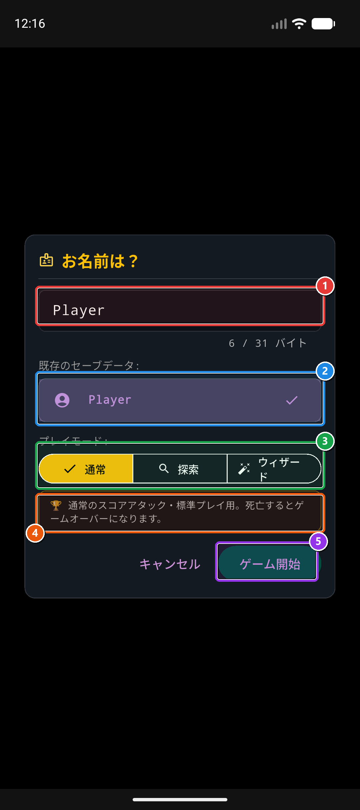
*図 2-1: 名前入力・セーブデータ選択・プレイモード選択ダイアログ*

1. **キャラクター名の入力**: 冒険者の名前を入力します（UTF-8 で最大 31 バイトまで）。入力した名前で新規作成またはセーブデータの検索が行われます。
2. **既存のセーブデータ**: すでに途中で中断セーブしているキャラクターがいる場合、リストに表示されます。タップして選ぶと、入力欄に名前が自動セットされ続きから再開できます。
3. **プレイモード切替（通常 / 探索 / ウィザード）**: ゲームの遊び方（3種類のモード）を選択します。
4. **選択中モードの説明欄**: 現在選んでいるプレイモードのルールと注意点が表示されます。
5. **ゲーム開始 / キャンセル**: 「ゲーム開始」をタップするとプロンプト入力を確定して冒険へ進みます（新規作成時はチュートリアル選択や職業・種族選択、またはランダム生成が続きます）。

### 3種類のプレイモードの違い

| モード名 | ルールと特徴 | ハイスコア記録 |
| :--- | :--- | :--- |
| **通常 (Normal)** | 本来のローグライク（パーマデス）。死亡すると冒険が終了し、記録がスコアボードに残ります。 | 記録される |
| **探索 (Explore)** | 死亡しても「死ぬのを思いとどまる（復活）」や物品生成などの補助機能を使いながらダンジョン探索・練習ができます。 | 記録されない（探索モード終了扱い） |
| **ウィザード (Wizard)** | デバッグ・実験用の管理者モードです。無敵化・任意のアイテム作成・階層移動などすべてのデバッグコマンドが利用できます。 | 記録されない |

---

## 3. メインゲーム画面の全体構成

冒険が始まると、上下または全体を使ったメインプレイ画面が表示されます。初期配置（レイアウトパターン1）では上から **ステータス → メッセージ → マップ → 操作パッド → コマンドパネル** の順に並びます。

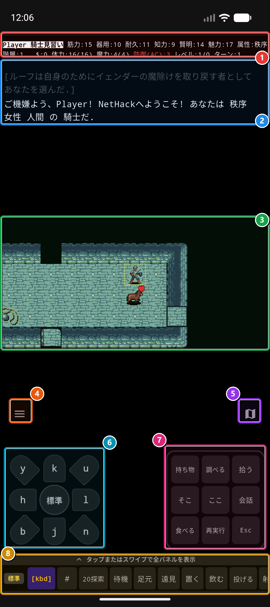
*図 3-1: メインゲーム画面（レイアウトパターン1・パネル折りたたみ時）*

1. **ステータス表示エリア**: キャラクター名・称号、能力値（筋力/器用/耐久/知力/賢明/魅力）、属性（秩序/中立/混沌）、現在階層・所持金 `$`・HP・魔力・防御力(AC)・経験レベル・経過ターン数などを表示します。`hitpointbar` 有効時は背景にHPゲージも表示されます。ステータス領域をタップすると能力値や耐性などのステータス詳細（`#attributes`）が表示され、武器や防具（`武器:` / `防具:` など）をタップ（またはステータス領域を長押し）すると装備一覧（`#seeall`）を確認できます。
2. **メッセージ表示エリア**: ゲーム内の行動結果やモンスターの攻撃・発見メッセージが表示されます。タップすると「メッセージ履歴」シートを開いて過去のログをさかのぼれます。
3. **ダンジョンマップ表示エリア**: 現在探索中のダンジョンを表示します。ドラッグで視点を動かし、ピンチイン／ピンチアウトで自由に拡大・縮小できます。マスをタップすると位置に応じた行動メニューが開きます。
4. **半透明メニューボタン（左）**: タップすると「DartHack メニュー」（第8章）を開きます。画面右端や左端など、設定で配置を変更できます。
5. **全体マップボタン（右）**: タップすると現在の階層の全体を見渡せる「階層の全体地図」ダイアログ（第4章）を開きます。
6. **8方向移動パッド＋移動モード切替**: 周囲の8つの菱形ボタン（`y k u / h . l / b j n`）で8方向へ移動・攻撃します。中央のボタン（初期状態は「標準」）をタップすると登録済みの移動モードを順番に切り替えられ（方向入力待ち中は `.` を送信）、**長押し**すると「使用する移動モードの選択」ダイアログ（ダッシュ等）を開きます。
7. **3×3 クイックショートカット**: 使用頻度の高い9個のコマンド（初期設定では「持ち物」「調べる」「拾う」「そこ」「ここ」「会話」「食べる」「再実行」「Esc」）を1タップで実行できるグリッドです。各ボタンを**長押し**すると、ボタンに割り当てるキー・コマンドと表示ラベルをその場で変更できます。
8. **コマンドパネル＆展開ハンドル**: よく使う行動ボタンをカテゴリ別リストにまとめた下部バーです。現在選択中のパネル内容が1行で表示され、上部のハンドルをタップまたは上スワイプすると全パネルを展開できます。また、パネル上の各ボタンを**長押し**すると、ボタンの追加・削除や割り当てキー・ラベルの変更を行えます。

> [!TIP]
> **気づきにくいタップ・長押しショートカットまとめ**
> - **ステータス領域をタップ**: 主人公のステータス詳細（能力値・耐性など）を表示 / **武器や防具をタップ（または領域を長押し）**: 装備一覧を表示
> - **8方向移動パッド中央ボタンを長押し**: 使用する移動モードの選択ダイアログを開く（タップでモード切替）
> - **3×3 クイックショートカットを長押し**: ボタンに割り当てるキー・コマンドと表示ラベルを変更
> - **コマンドパネルのボタンを長押し**: ボタンの変更・追加・削除・パネル初期化メニューを開く

### コマンドパネルの全展開表示

コマンドパネルのハンドル（1）を上方向へスワイプまたはタップすると、登録されているすべてのパネルが縦に展開されます。

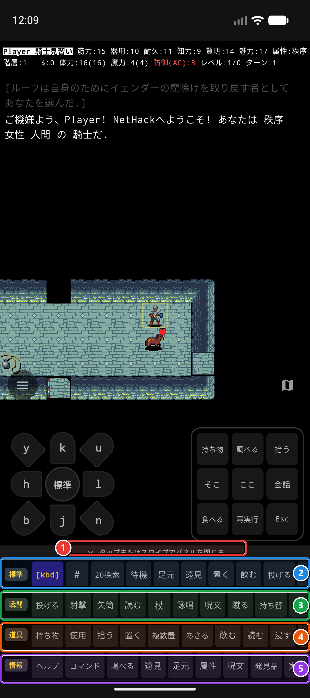
*図 3-2: 下部コマンドパネルを全展開した状態*

1. **折りたたみ・展開ハンドル**: タップまたは下方向へスワイプすると、再び1行のコンパクト表示へ戻ります。
2. **標準パネル**: 左端の `[kbd]`（または `[pad]`）ボタンでソフトキーボード表示と移動パッド表示を切り替えます。`#`（拡張コマンド）、`20探索`、待機、足元、遠見、置く、飲む、投げるなど基本行動が並びます。
3. **戦闘パネル**: 投げる、射撃、矢筒、読む、杖、詠唱、呪文、蹴る、持ち替など戦闘寄りのコマンドを集めたパネルです。
4. **道具パネル**: 持ち物、使用、拾う、置く、複数置、あさる、飲む、読む、浸すなどアイテム操作に特化したパネルです。
5. **情報パネル**: ヘルプ、コマンド、調べる、遠見、足元、属性、呪文、発見品、実績など情報確認用コマンドをまとめています。

> [!TIP]
> 左端のパネル名ボタン（例：「標準」「戦闘」など）をタップしてパネルを直接切り替えたり、横スクロールで隠れている右側のボタンを使ったりできます。パネル上の各ボタンを**長押し**するとその場でボタンの追加・削除やキー・ラベルの変更ができ、「詳細ゲーム設定 → カスタムコマンドパネル編集」（第13章）からもパネル構成をまとめて編集できます。

### コマンドパネルの長押しカスタマイズ

コマンドパネル上の編集したいボタン（例：`20探索` など）を**長押し**すると、「ボタン編集」ダイアログが開き、設定画面を開かなくてもその場でカスタマイズできます。

*図 3-3: コマンドパネルのボタンを長押しして開くボタン編集メニュー*

1. **編集対象ヘッダー**: 長押ししたボタンの現在割り当てられているコマンド（例：`ボタン編集: 20s`）を表示します。
2. **コマンド・ラベル変更**: 「コマンドを変更」で実行するキーやコマンド（例：`20s`, `w`, `#pray`）を書き換え、「表示ラベルを変更」でボタン上の表示名を変更できます（未設定時はコマンド名を表示）。
3. **ボタンの挿入**: 「前にボタンを追加」「後にボタンを追加」で、選択したボタンの前後へ新しいボタンを追加します。
4. **削除・初期化**: 「ボタンを削除」でそのボタンを取り除き、「パネルをデフォルトに戻す」で選択中のパネルを初期状態へリセットします。
5. **キャンセル**: 変更を行わずにダイアログを閉じます。

---

## 4. 移動操作・マップタップ・全体マップ

### 移動モードの切り替え

8方向移動パッド中央のボタン（「標準」など）を**長押し**すると、「使用する移動モードの選択」ダイアログが開きます。ここで一時的な移動モードや常時オプション（`F`）を切り替えられます（中央ボタンを短くタップすると、有効化されている移動モードを順番に切り替えられます）。

*図 4-1: 使用する移動モードの選択ダイアログ*

1. **ダイアログ見出し**: 使用する移動モードを選択する画面です。
2. **標準（1マス移動）**: `yuhjklbn` による通常の1歩移動に戻します。
3. **長距離移動系（大文字 / `g` / `G` / `^(Ctrl)`）**: 壁や扉にぶつかるまで走る **大文字 (`YUHJKLBN`)**、興味深いものが見つかるまで進む **`g<dir>`**（分岐で停止）、分岐を無視して進み続ける **`G<dir>` / `^<dir>`** の4種から選べます。
4. **`m` モード（`m<dir>`）**: 足元のアイテムを拾わずに移動したり、トラップや水・溶岩などの危険地形（自己責任）へ踏み込んだりしたいときに選びます。
5. **`F` モード（`F<dir>`）**: 見えていない・感知していないモンスターがいると思われる方向へ強制的に攻撃します（透明な敵や暗闇での戦闘に有効）。チェックを入れると設定が維持されます。
6. **キャンセル / OK**: 変更を確定して画面へ戻ります。

### マップの直接タップ操作（コンテキストメニュー）

ダンジョンマップ上のマスをタップすると、タップした場所（自分の足元・隣接8マス・離れた場所）に応じた行動メニューが自動で開きます。

*図 4-2: 足元・周辺マスをタップしたときの行動メニュー例*

1. **メニュー見出し**: 選んだ位置に対して実行する行動の選択プロンプト（「何をしますか？」など）です。
2. **文脈に応じたアクション一覧**: 足元をタップ時は「階段を上る」「持ち物を見る」「周囲を探す」「ここで祈る」等、隣接マスをタップ時は「ここに移動する」や扉の開閉・攻撃・会話、離れたマスでは遠見やその方向への移動候補が提示されます。
3. **キャンセルボタン**: メニューを閉じてマップへ戻ります。

### 全体マップ表示

画面右側の半透明マップボタン（または `F9` / `Alt-z` キー）を押すと、現在の階層全体を見渡す「階層の全体地図」ダイアログが開きます。

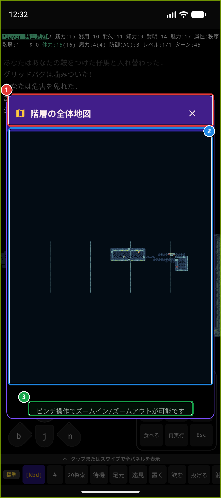
*図 4-3: 現在の階層全体を確認できる全体地図ダイアログ*

1. **ヘッダーと閉じるボタン (`×`)**: 右上の `×` をタップするか、下のマップ領域外・Esc キーで閉じます。
2. **階層全体ビュー**: これまで探索して記憶している部屋・通路・階段・祭壇などの全体像が描画されます。ドラッグでスクロールできます。
3. **ピンチズーム案内**: 2本指でのピンチイン／ピンチアウトで全体図の拡大率を細かく調整できます。

---

## 5. ソフトキーボード・文字入力・拡張コマンド

### ソフトキーボード（フルキーボード）

コマンドパネル左側の `[kbd]` ボタンをタップすると、移動パッド＋ショートカットの代わりに英字フルキーボードが表示されます。アルファベットのコマンド（例：`q` 飲む、`r` 読む、`t` 投げるなど）を直接打ちたいときや、`Ctrl` 修飾が必要な操作に最適です。

*図 5-1: ソフトキーボード表示（フルキーボード）*

1. **QWERTY キー配列部**: `q`〜`p` / `a`〜`l` / `z`〜`m` と `Shift`（大文字切替）、`Del` キーを配置しています。
2. **修飾・特殊記号バー**: `?123`（数字・記号パネル切替）、`Meta`（Alt/Meta 修飾：階段探索や全体マップ等）、`<`、`>`（上り階段・下り階段）、`:`（足元を見る）、`,`（拾う）、`Ctrl`（コントロール修飾：`Ctrl+x` 等）、`Enter` を素早く入力できます。
3. **`[Pad]` 切替ボタン**: タップするとソフトキーボードを閉じて、元の「8方向移動パッド＋3×3ショートカット」表示へ戻ります。
4. **コマンドパネル一覧**: キーボード展開中でも、標準・戦闘・道具・情報パネルの各コマンドを組み合わせて利用できます。

### 拡張コマンド（`#` コマンド一覧）

コマンドパネルの `#` をタップ（またはキーボードで `#` を入力）すると、すべての拡張コマンド一覧ダイアログが開きます。NetHack 特有の複雑なコマンドをうろ覚えのまま探せる強力な機能です。

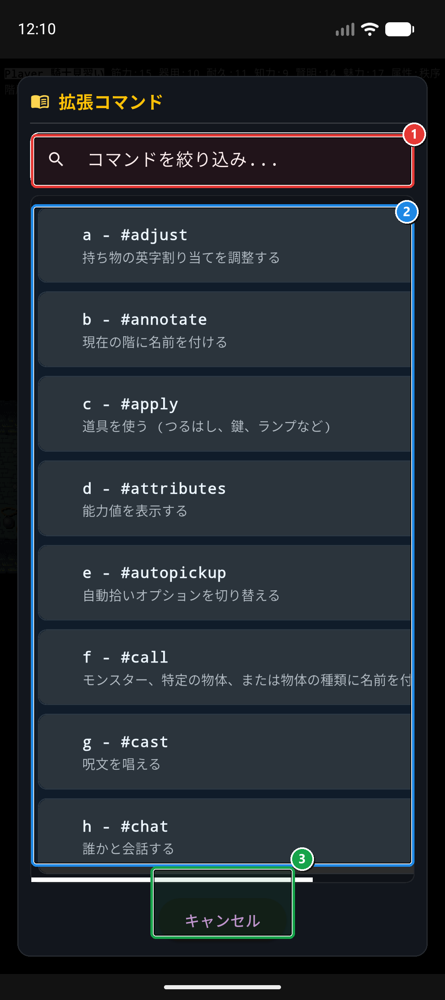
*図 5-2: 日本語説明・絞り込み検索付きの拡張コマンドダイアログ*

1. **絞り込み検索欄**: コマンド名の一部（`adjust`, `pray`, `loot` 等）や説明キーワードを入力すると、候補をリアルタイムで絞り込めます。
2. **拡張コマンドリスト**: アルファベット記号（`a`, `b`, `c`...）と `#command` 名、および動作解説が表示されます。行をタップするだけで直接実行できます。
3. **キャンセルボタン**: 拡張コマンドを実行せずに閉じます。

---

## 6. アイテム操作メニューと名付け・文字入力プロンプト

### アイテム選択メニュー

持ち物一覧（`i`）や装備（`W`/`w`）、飲む（`q`）、読む（`r`）などのアイテム選択時には、タイル画像付きの分かりやすいカテゴリ分けメニューが表示されます。

*図 6-1: 武器・防具・食べ物などカテゴリ分けされたアイテム選択メニュー*

1. **カテゴリ見出し**: 「武器」「防具」「食べ物」などのカテゴリ見出しが黄色い枠で区分けされ、目的のアイテムをすぐに見つけられます。
2. **アイテム行（アイコン＆状態カラー）**: 各行に割り当て文字（`a`, `b`, `c`...）とタイルアイコン、アイテム名、数量や装備状態（`右手に装備中` / `装備中` / `予備武器` など）が表示されます。祝福・無祝福・呪い状態が文字色で視認しやすくなっています。
3. **キャンセルボタン**: 選択を取り消してゲーム画面に戻ります。

### テキスト入力・名付けプロンプト

アイテムに名前を付ける（`#name` / `C`）ときや、願い事・階層の注釈・金額入力などでは専用のテキスト入力ダイアログが開きます。

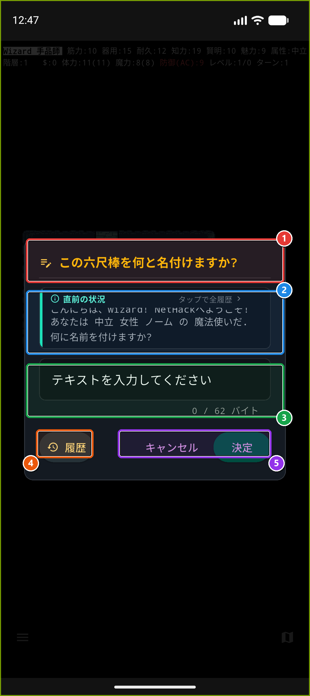
*図 6-2: 直前メッセージ参照・入力履歴・バイト数表示付きの入力プロンプト*

1. **プロンプト質問見出し**: 何の入力を求められているか（例：「この六尺棒を何と名付けますか？」）が上部に大きく表示されます。
2. **直前の状況カード（タップで全履歴）**: 直前にゲーム画面へ出た関連ログを確認できるため、「何を識別して名付ける場面か」を見失いません。右上の「タップで全履歴 >」から過去ログ全体も確認できます。
3. **テキスト入力欄とバイト数カウンター**: OS の日本語入力（IME）を使ってそのまま入力できます。NetHack C コア側の制限に合わせた残バイト数（例：`0 / 62 バイト`）が表示され、全角英数字・記号は C コア側で自動正規化されます。
4. **履歴ボタン**: 過去に入力した文字列を呼び出して再入力できます。
5. **キャンセル / 決定ボタン**: 入力を確定して C コアへ送信するか、キャンセルします。

---

## 7. メッセージ履歴とスポイラー（攻略情報）

### メッセージ履歴の表示

画面上部のメッセージ領域をタップすると、これまでの冒険メッセージ履歴をさかのぼって確認できるボトムシートが開きます。

*図 7-1: 過去の冒険メッセージ一覧を表示するメッセージ履歴画面*

1. **履歴シートヘッダー**: 「メッセージ履歴」の見出しと操作ヒント（「タップまたは下スワイプで閉じる」）が表示されます。
2. **色分け済みメッセージログ**: 新しい・重要な警告（飢えやダメージ等）は強調色で表示され、スクロールして何ターンも前の状況を確認できます。
3. **閉じるボタン**: 下部の「閉じる」ボタンをタップするか、シートを下にスワイプするとメイン画面へ戻ります。

### スポイラー（攻略情報）ビューア

タイトル画面の本アイコン、またはゲーム中の「DartHack メニュー → スポイラーを読む」から攻略データベースを開けます。

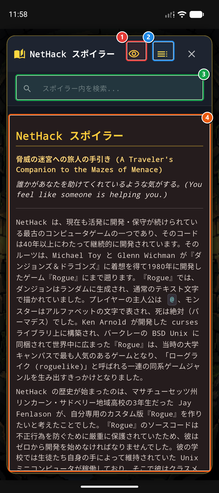
*図 7-2: 検索・目次・画面一時確認に対応したスポイラービューア*

1. **ゲーム画面を一時確認（「覗き見」ボタン）**: タップで維持・長押しで一時透過することで、スポイラーを閉じずに背後のゲーム画面（マップやメッセージ）をそのまま覗き見ることができます。
2. **目次を開く**: 章ごとの目次モーダルを開き、読みたい攻略セクションへ一発でジャンプできます。
3. **スポイラー内を検索**: キーワード検索欄に調べたいアイテム名や用語を入力して、該当箇所をすぐ探せます。
4. **攻略本文エリア**: 読みやすく整形されたテキストやシンボル付きで攻略情報が表示されます。`ガイドブックを読む` でも同様のビューアが利用可能です。

---

## 8. DartHack メニュー（ドロワーメニュー）

左側の半透明メニューボタンをタップ（または画面左端から右スワイプ、キーボードの `Ctrl+M` / `F10`）すると、各種機能へアクセスできる「DartHack メニュー」が開きます。

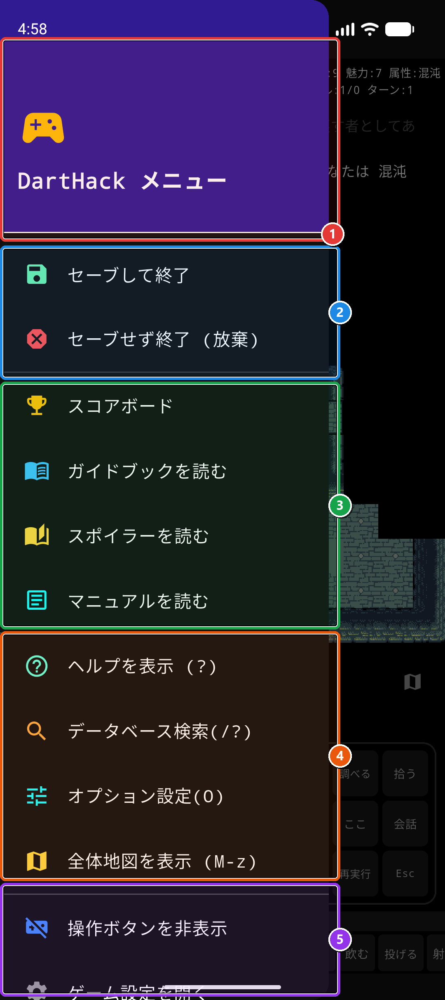
*図 8-1: アプリ機能・ゲームコマンドへ素早くアクセスできるドロワーメニュー*

1. **メニューヘッダー**: 「DartHack メニュー」のタイトル領域です。
2. **セーブと終了操作**: **セーブして終了**（進行状況を保存して安全終了）と **セーブせず終了（放棄）**（セーブを残さず現在の冒険を破棄・確認ダイアログあり）が並びます。
3. **記録・ドキュメント閲覧**: **スコアボード**（第9章）、**ガイドブックを読む**（公式ルール解説）、**スポイラーを読む**（攻略データベース）、**マニュアルを読む**（本マニュアルをオフライン閲覧）を開きます。
4. **ゲーム補助コマンド・検索・画面切替**: **ヘルプを表示 (`?`)**、**データベース検索 (`/?`)**、**オプション設定 (`O`)**、**全体地図を表示 (`M-z`)** を直接呼び出せます。
5. **UI・アプリ設定**: **操作ボタンを非表示**（マップを広く見たいときにパッド等を一時非表示）と **ゲーム設定を開く**（詳細ゲーム設定画面へ移動）を実行します。

---

## 9. スコアボード・記録詳細・墓石表示

### スコアボードと今回の記録

冒険を終了（死去・昇天・脱出等）したとき、またはメニューから「スコアボード」を開いたときに、歴代ランキングが表示されます。

*図 9-1: カード形式で分かりやすく整形されたスコアボード画面*

1. **スコアボード見出し**: ランキング一覧画面のヘッダーです。
2. **ハイスコアカード（「今回の記録」ハイライト）**: 順位バッジ・合計点数・キャラクタープロフィール（名前/職種/種族/性別/信仰・守護神）・死因・到達階層・HP/最大HPがカードで表示されます。プレイ直後の自身の結果には黄色枠と「今回の記録 / Current Game」バッジが付きます。
3. **「詳細 >」ボタン**: 各カード右上の「詳細 >」をタップすると、そのプレイの詳細な統計情報（`xlogfile` 由来データ）を確認できます。
4. **履歴 / OK ボタン**: 「履歴」から終了直前ログを振り返ったり、「OK」でスコアボードを閉じて次へ進んだりできます。

### プレイ詳細と統計（xlogfile）

スコアボードの「詳細 >」をタップすると、冒険の記録と詳細統計が一覧表示されます。

*図 9-2: 死因・到達状況・プレイ統計（xlogfile）・達成項目を確認できる詳細画面*

1. **選択エントリーサマリー**: 順位・スコア点数とキャラクターの基本情報です。
2. **冒険の結果・到達状況**: 結末（死因）・場所と最大到達階層・HP / 最大HP・所持金 (`Zm`)・これまでの死亡回数などを確認できます。
3. **プレイ統計 (`xlogfile`)**: 開始日時・終了日時・実プレイ時間・経過ターン数・願い回数（うちアーティファクト数）・骸骨ファイル（`bones`）およびリロール回数・NetHack バージョンを記録・表示します。
4. **達成項目**: ゲーム中に達成した各種実績・特別功績（Conduct 等）が表示されます。
5. **閉じるボタン**: スコアボード一覧へ戻ります。

### 死亡時の墓石画面

キャラクターが死亡すると、アスキー／ピクセルアートで描かれた墓石画面と追悼メッセージが表示されます。

*図 9-3: R.I.P. ピクセルアートと追悼文が表示される墓石画面*

1. **墓石ピクセルアート（R.I.P. 碑文）**: キャラクター名・死因・亡くなった年が刻まれた墓石ビジュアルが表示されます。
2. **追悼サマリー文**: どこで何を残しどのように生涯を終えたかの要約メッセージです。
3. **確認ボタン（履歴 / OK）**: 「履歴」で最後のメッセージログを確認するか、「OK」をタップしてスコアボード表示へ進みます。

---

## 10. 画面表示・ステータス・フォント設定

タイトル画面の歯車アイコン、または「DartHack メニュー → ゲーム設定を開く」から **「詳細ゲーム設定」** 画面を開けます。ここでは表示・操作のあらゆる項目を好みに合わせて細かく調整できます。

### ステータス領域設定

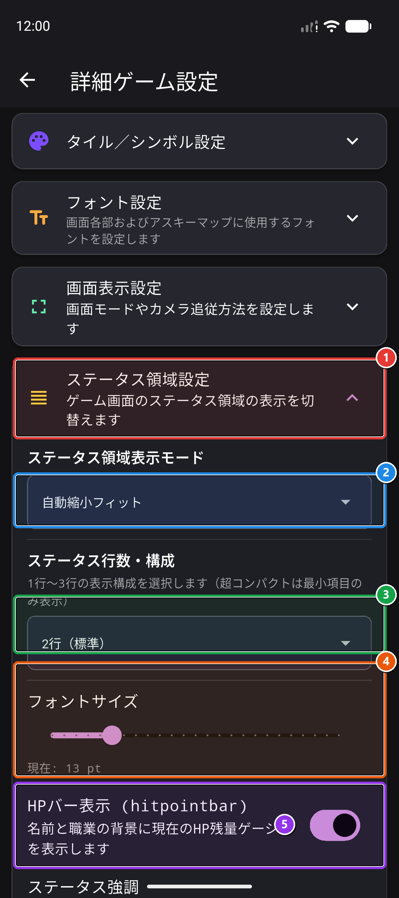
*図 10-1: ステータス表示エリアのフィット・行数・フォントサイズ・HPバー設定*

1. **ステータス領域設定ヘッダー**: タップでセクションを展開／折りたたみできます。
2. **ステータス領域表示モード**: 画面幅に合わせて文字を自動縮小する「自動縮小フィット」などの表示方法を選択します。
3. **ステータス行数・構成**: 1行〜3行（超コンパクトは最小項目のみ）など、画面の縦スペースに応じてステータス行の構成を切り替えます。
4. **フォントサイズスライダー**: ステータス欄の文字サイズ（例：`13 pt`）をスライダーで微調整します。
5. **HPバー表示 (`hitpointbar`)**: ON にするとキャラクター名と職業の背景に現在のHP残量ゲージを重ねて表示します（下部には状態に応じた色分けを行う「ステータス強調」設定も続きます）。

### 画面表示設定（画面モード・物理キーヘルプ・カメラ追従）

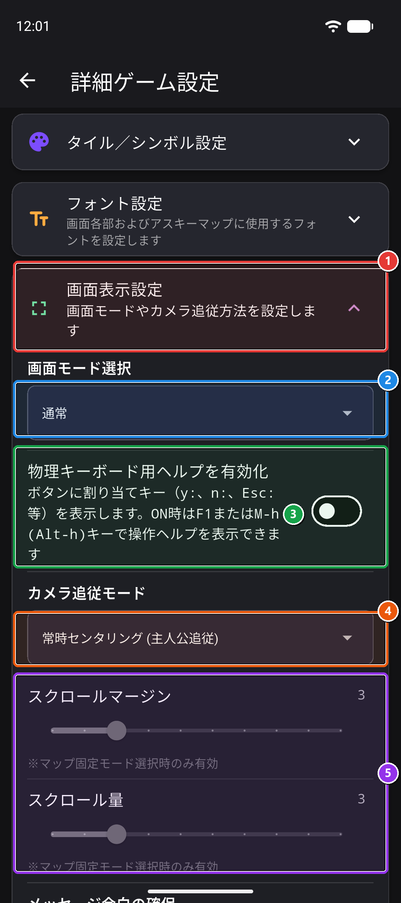
*図 10-2: 画面モード・物理キーボード用ヘルプ・カメラ追従モード設定*

1. **画面表示設定ヘッダー**: 画面モードとカメラ追従方法を設定するセクションです。
2. **画面モード選択**: 通常表示や全画面表示などの画面モードを選びます。
3. **物理キーボード用ヘルプを有効化**: ON にするとボタン上にショートカット文字（`y:`, `n:`, `Esc:` 等）が表示され、`F1` または `M-h (Alt-h)` で操作ヘルプダイアログを開けるようになります。
4. **カメラ追従モード**: 移動ごとに主人公を画面見やすい位置に保つ **常時センタリング（主人公追従）** と、PC 版のように画面端へ近づいたときだけスクロールする **マップ固定モード（端スクロール）** を切り替えます。
5. **スクロールマージン＆スクロール量**: 「マップ固定モード」を選択している場合に有効になり、端から何マス手前でスクロールを開始するか（スクロールマージン）と、1回のスクロールで何マス移動させるか（スクロール量）を調整できます。

### フォント設定

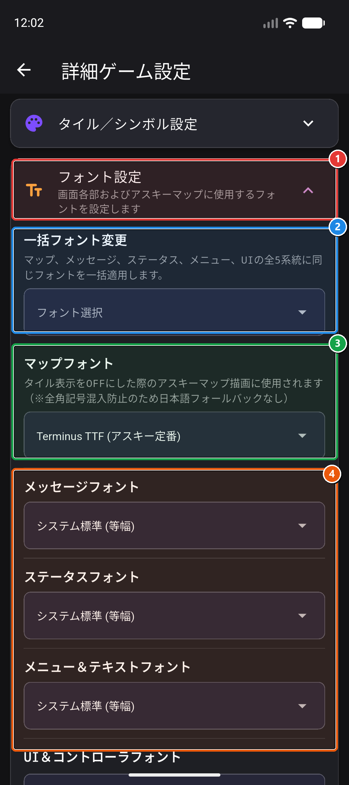
*図 10-3: マップ用・メッセージ用など5系統のフォント設定*

1. **フォント設定ヘッダー**: アプリ全体のUIやアスキーマップに使うフォントを調整するセクションです。
2. **一括フォント変更**: マップ・メッセージ・ステータス・メニュー・UIの全5系統に同じフォントを一度に適用します。
3. **マップフォント**: タイル表示を OFF にした「ASCII マップ」描画時に使う専用フォントを選択します（デフォルトは `Terminus TTF (アスキー定番)`。罫線・位置ズレを防ぐため全角フォールバックを無効化した等幅フォントを採用しています）。
4. **個別フォント設定**: メッセージフォント・ステータスフォント・メニュー＆テキストフォント・UI＆コントローラフォントを用途ごとに個別に変更できます。

---

## 11. タイルセットの選択とカスタムタイルセット

詳細ゲーム設定の先頭にある「タイル／シンボル設定」からタイル表示の ON/OFF と「タイルセットの選択」画面を開けます（ASCII 文字での古典的なプレイに切り替えたい場合はタイル表示を OFF にします）。

*図 11-1: 標準同梱タイルセットおよび外部カスタムタイルセットの管理画面*

1. **外部タイルセットを追加 (`.png` / `.webp` / `.bmp`)**: お使いの端末に保存されている NetHack 用スプライトシート画像を選択して追加できます。NetHack 標準の **横40列仕様（`画像横幅 ÷ 40`）** を自動判定し、非正方形タイル（例：`15x25` 等）も正確なアスペクト比で描画します。
2. **タイルセット一覧と現在選択中のカード**: 標準で複数の高品質タイルセットを同梱しています（デフォルトは `PixelHack (32x32)`）。各カードには解像度サイズ・作者名が明記され、現在適用中のセットには「選択中」バッジが表示されます。
3. **配布 URL コピーアイコン**: 各タイルセットの参照 URL 脇のアイコンをタップすると、配布元 URL をクリップボードへコピーできます。

### 同梱されている主なタイルセット

| タイルセット名 | 解像度 | 特徴 |
| :--- | :--- | :--- |
| **Default** | `16x16` | NetHack 本家標準のクラシックな小型タイル |
| **Nevanda** | `32x32` | 見やすく親しみやすいデザインの定番タイルセット |
| **PixelHack** | `32x32` | 視認性とドット絵の美しさを両立した初期選択タイル |
| **ZeldHack** | `32x32` | ファミコン風の色彩豊かなグラフィックタイル |
| **KevinTam tiles** | `64x64` | 高精細・透過背景対応（ダンジョンの床・地形の2層描画に対応） |

---

## 12. UI配置カスタマイズとタブレット対応

### レイアウトパターンと左右入替設定

手の大きさや持ち方、端末の向きに合わせて、操作 UI の上下関係や左右配置を変更できます。

*図 12-1: 画面レイアウトパターン1／2 の切替画面*

1. **UI配置カスタマイズヘッダー**: 画面レイアウトの構成を変更するセクションです。
2. **レイアウトパターン選択**: **パターン1**（上=ステータス・メッセージ / 中央=マップ / 下=移動パッド・ショートカット）と **パターン2**（上下反転）を切り替えます。さらに下には「移動パッドとショートカットの左右を入れ替える」「半透明メニューボタンの配置位置」オプションもあります。

### 横画面・タブレット端末での表示比較

タブレット端末や大画面の横向き表示では、ワイド画面を活かして広大なダンジョン領域と全表示に近いワイドコマンドパネルが自動的に最適化されます。

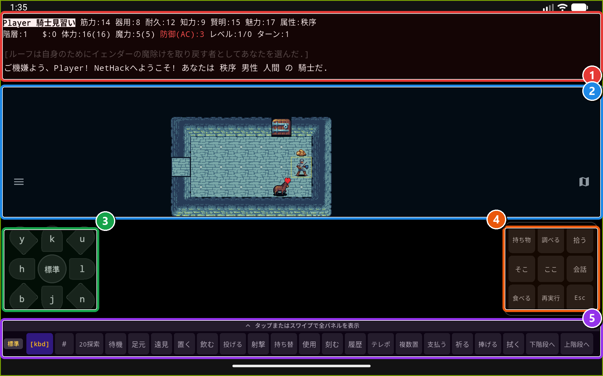
*図 12-2: 大画面タブレット横向き（1920x1200 等）でのプレイ画面*

1. **上部ステータス＆メッセージ領域**: 横長レイアウトによりステータス項目が1〜2行にすっきり収まり、メッセージもゆったり表示されます。
2. **広域マップエリア＋左右ボタン**: 横幅いっぱいに広いダンジョン領域が確保され、左右端に半透明メニューボタンと全体マップボタンが干渉せず配置されます。
3. **左下 8方向移動パッド**: 左手親指が届きやすい左下に配置されます。
4. **右下 3×3 クイックショートカット**: 右手親指で素早く押せる右下に配置されます。
5. **最下部ワイドコマンドパネル**: 多数のコマンドボタンがスクロール不要に近い横幅で並び、拡張操作にすぐアクセスできます。

---

## 13. コマンドパネル・クイックボタンの編集

ゲーム画面最下部のコマンドパネル群は、プレイヤー自身のプレイスタイルに合わせて自由に追加・編集・並べ替えを行えます。

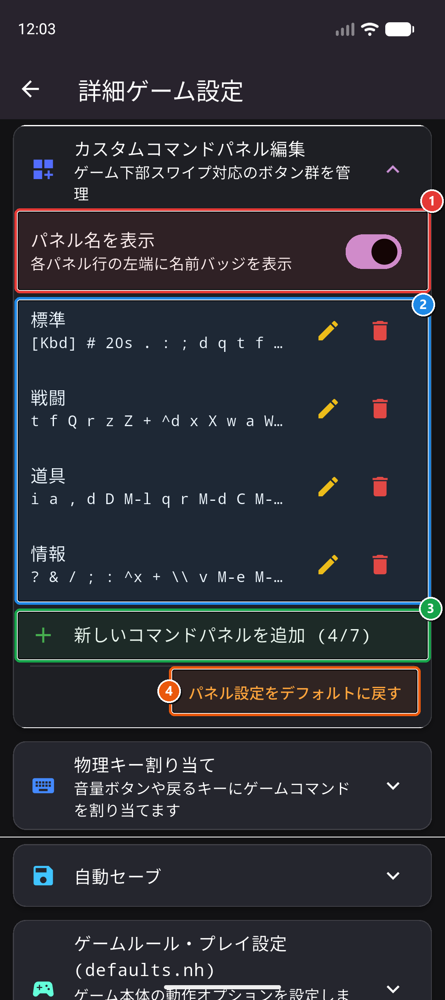
*図 13-1: コマンドパネルの一覧管理・編集・新規追加・リセット画面*

1. **パネル名を表示トグル**: 各コマンドパネル行の左端に「標準」「戦闘」「道具」「情報」などの名前バッジを表示するかどうかを切り替えます（非表示にすると横幅をより広く使えます）。
2. **登録済みパネル一覧（編集／削除アイコン）**: 各パネルのタイトルと先頭コマンド一覧が表示されます。右側の **鉛筆アイコン** で中のボタン名・送信コマンド・順序を編集でき、**ゴミ箱アイコン** でカスタムパネルを削除できます。
3. **新しいコマンドパネルを追加**: オリジナルのコマンドパネルを作成します（最大 7 個まで登録可能）。魔法使い用の呪文ショートカット集や、よく使う `#` 拡張コマンドだけを並べたパネルなどを作れます。
4. **パネル設定をデフォルトに戻す**: カスタマイズ内容を初期化し、標準・戦闘・道具・情報の初期構成へ戻します。

> [!TIP]
> 3×3 クイックショートカットについても、「詳細ゲーム設定」の **「クイックショートカット設定」** から9マスのボタン内容を個別に編集できます。また、メインゲーム画面上でも、コマンドパネルの各ボタンや 3×3 クイックショートカットのボタンを**長押し**することで、その場ですぐにキーやラベルを編集できます（第3章「コマンドパネルの長押しカスタマイズ」参照）。

---

## 14. 物理キーボード操作ガイドと物理キー割り当て

### 物理キーボード接続時のショートカット操作

Bluetooth キーボードや Chromebook・PC・USB キーボードを接続している場合、NetHack 標準キーに加えて DartHack UI 専用の便利ショートカットキーを使用できます。設定画面の **「詳細ゲーム設定 → 画面表示設定 → 物理キーボード用ヘルプを有効化」** をオンにしている場合、`F1` または `Alt-h (M-h)` キーを押すといつでも操作ガイドを表示できます。

*図 14-1: 物理キーボード用ショートカット操作ガイド*

1. **操作ガイドヘッダーと閉じるボタン (`×`)**: `F1` または `Alt-h` で開くガイド画面です。
2. **UI 専用ショートカットキー一覧**: `Ctrl+M` / `F10`（ドロワーメニュー一発起動）、`F9` / `Alt-z`（全体地図）、`Tab` / `Shift+Tab`（半透明ボタンのフォーカス移動）、`Enter` / `Space`（選択中の半透明ボタンを実行）、`?`（NetHack 標準ヘルプ）、`F1` / `Alt-h`（操作ヘルプ）が使えます。
3. **下部の操作案内**: `Space` で下へスクロール（最下部でもう一度押すと閉じる）、`Esc` または `Enter` で即座に終了します。

### 物理キー割り当て（音量ボタン・戻るボタン）

キーボードが無い端末でも、本体側面の **音量ボタン** や Android の **戻るボタン／ジェスチャー** に任意の NetHack コマンド（`s` 探索、`.` 休息、`Esc` キャンセル等）を割り当てられます。

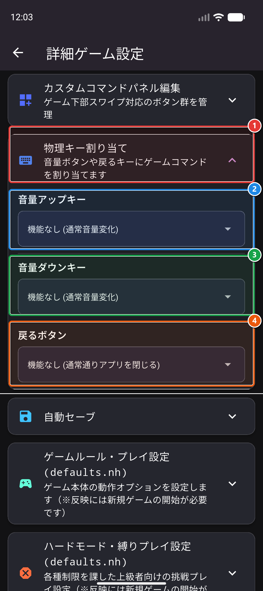
*図 14-2: 音量アップ／ダウンキー・戻るボタンのコマンド割り当て設定*

1. **物理キー割り当てヘッダー**: 本体ハードウェアキーの挙動を設定するセクションです。
2. **音量アップキー**: 音量＋ボタンに割り当てるコマンドを選びます（初期値：`機能なし（通常音量変化）`）。
3. **音量ダウンキー**: 音量－ボタンに割り当てるコマンドを選びます（初期値：`機能なし（通常音量変化）`）。
4. **戻るボタン**: 戻る操作にコマンドや確認動作を割り当てます（初期値：`機能なし（通常通りアプリを閉じる）`）。誤バックによる中断を防ぎたい場合は割り当て変更が便利です。

---

## 15. サウンド設定とハードモード・縛りプレイ

### サウンド設定（BGM・効果音・環境音）

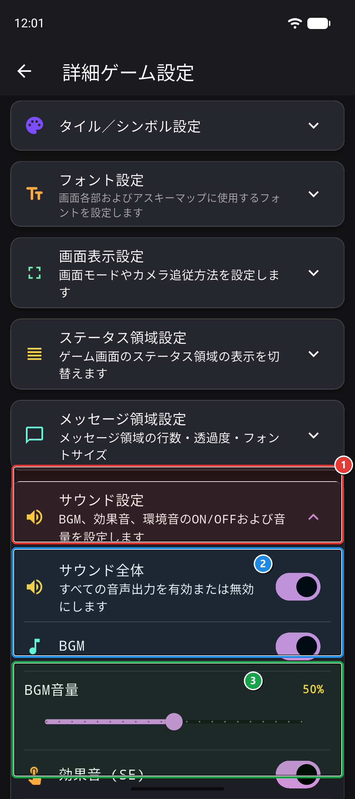
*図 15-1: サウンド全体・BGM・効果音(SE)・環境音の設定画面*

1. **サウンド設定ヘッダー**: BGM・効果音・環境音の ON/OFF や音量を調整するセクションです。
2. **サウンド全体・BGM スイッチ**: 「サウンド全体」ですべての音声出力を一括ミュート／有効化できます。その下にある「BGM」スイッチでダンジョン層・特殊部屋に応じたBGM再生を個別に切り替えられます。
3. **BGM音量・効果音（SE）・環境音**: スライダーで BGM や各種音声バランスを細かく調整し、戦闘・扉開閉・環境音（祭壇・お店・水辺など）を好みに合わせて切り替えられます。

### ゲームルール・プレイ設定とハードモード・縛りプレイ

`defaults.nh` に連動するゲーム本体の各種プレイ設定や、熟練者向けの制限プレイ（縛りプレイ / Challenges）をトグル操作だけで簡単に設定できます。

*図 15-2: ゲームルール設定とハードモード・縛りプレイトグル一覧*

1. **ゲームルール・プレイ設定 (`defaults.nh`)**: 自動拾い（`autopickup`）・時間表示・確認プロンプトなど、NetHack 本体の標準動作オプションを設定できます（※変更の反映には **新規ゲームの開始** が必要です）。
2. **ハードモード・縛りプレイ設定 (`defaults.nh`) ヘッダー**: 上級者向けの挑戦プレイ設定セクションです（※反映には **新規ゲームの開始** が必要です）。
3. **縛りプレイ・チャレンジ項目**: **全盲縛り (`blind`)**、**裸族縛り (`nudist`)**、**聾唖縛り (`deaf`)**、**一文無し縛り (`pauper`)** など各種制限をトグルで ON/OFF できます（下にスクロールするとさらに多くのチャレンジ設定が表示されます）。

---

## 16. 高度な設定（defaults.nh 編集と設定のバックアップ）

設定画面の最下部には、NetHack 上級者向けのオプションファイル直接編集と、端末間でカスタマイズを引き継ぐエクスポート／インポート機能があります。

*図 16-1: defaults.nh 直接編集および設定エクスポート／インポート*

1. **高度な設定ヘッダー**: 上級者向けの設定管理セクションです。
2. **`defaults.nh` を手動で編集**: UI トグルにない細かな NetHack オプション（メニューカラー設定、ステータス強調ルール、`OPTIONS=...` のカスタム記述など）をテキストエディタで直接編集できます（※編集内容の反映には **新規ゲームの開始** が必要です）。
3. **設定をエクスポート／インポート**: **設定をエクスポート** で現在のフォント・UI配置・カスタムコマンドパネル・ショートカット・表示設定を JSON 文字列としてクリップボードにコピーでき、その下の **設定をインポート** で貼り付けて別端末や再インストール後に瞬時に復元できます。

---

*よりよい冒険を！ May the RNG smile upon you!*
