# DartHack 操作マニュアル

DartHack は、名作ローグライクゲーム **NetHack 5.0**（日本語版 **NetHackJP** および英語版 **NetHack** 本家コア）をスマートフォンやタブレットで快適にプレイできるよう Flutter/Dart で構築したアプリです。

このマニュアルでは、タイトル画面の起動から基本の冒険操作、画面上のタップ・キーボード・物理キー操作、さらにタイルセット・フォント・UI配置・サウンド・縛りプレイ・`defaults.nh` 編集などの詳細設定までを、実際のゲーム画面（番号付き枠線付き）とあわせて解説します。

> [!TIP]
> 画面はタップ・ドラッグ・ピンチ操作に対応しています。また、ハードウェア（物理）キーボードを接続した状態でのキーボード操作もサポートしています。

---

## 1. アプリ起動とタイトル画面

アプリを起動すると、最初にタイトル画面が表示されます。冒険を始める前の言語切替やゲーム設定、説明書・攻略情報の閲覧をここから行えます。

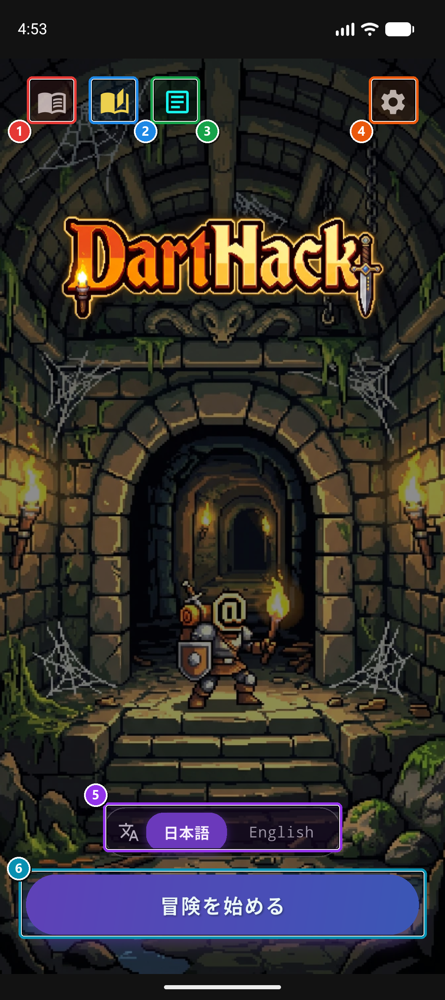
*図 1-1: タイトル画面の各ボタン構成*

1. **遊び方・ガイドブック**: NetHack の公式ガイドブック（遊び方や基本ルール）をアプリ内で開きます。ゲーム開始前でも読めるため、初めてプレイする際の確認に便利です。
2. **スポイラー（攻略情報）**: ゲームの仕様やアイテム効果・モンスター情報などの攻略資料（NetHack スポイラー）を閲覧できます。
3. **DartHack マニュアル**: この DartHack ユーザーマニュアルをアプリ内でオフライン閲覧できます。
4. **詳細ゲーム設定**: タイルセット・フォント・画面レイアウト・サウンド・`defaults.nh` などの詳細設定画面を開きます。
5. **表示言語の切替（日本語 / English）**: ボタンをタップして **日本語（NetHackJP コア）** と **English（NetHack オリジナルコア）** を切り替えます。タイトル画面およびゲーム全体のUI・エンジン言語が切り替わります。
6. **冒険を始める**: キャラクター作成（名前の入力）および既存セーブデータの再開ダイアログへ進みます。

> [!NOTE]
> 遊びたい言語（日本語または英語）をタイトル画面で選んでから「冒険を始める」を押してください。

---

## 2. キャラクター作成と冒険の開始

「冒険を始める」をタップすると、プレイヤー名とプレイモードを指定する「お名前は？」ダイアログが表示されます。

*図 2-1: 名前入力・セーブデータ選択・プレイモード選択ダイアログ*

1. **キャラクター名の入力**: 冒険者の名前を入力します（UTF-8 で最大 31 バイトまで）。入力した名前で新規作成またはセーブデータの検索が行われます。
2. **既存のセーブデータ**: すでに途中で中断セーブしているキャラクターがいる場合、リストに表示されます。タップして選ぶと、入力欄に名前が自動セットされ続きから再開できます。
3. **プレイモード切替（通常 / 探索 / ウィザード）**: ゲームの遊び方（3種類のモード）を選択します。
4. **選択中モードの説明欄**: 現在選んでいるプレイモードのルールと注意点が表示されます。
5. **ゲーム開始 / キャンセル**: 「ゲーム開始」をタップするとプロンプト入力を確定して冒険へ進みます（新規作成時はチュートリアル選択や職業・種族選択、またはランダム生成が続きます）。

### 3種類のプレイモードの違い

| モード名 | ルールと特徴 | ハイスコア記録 |
| :--- | :--- | :--- |
| **通常 (Normal)** | 本来のローグライク（パーマデス）。死亡すると冒険が終了し、記録がスコアボードに残ります。 | 記録される |
| **探索 (Explore)** | 死亡しても「死ぬのを思いとどまる（復活）」や物品生成などの補助機能を使いながらダンジョン探索・練習ができます。 | 記録されない（探索モード終了扱い） |
| **ウィザード (Wizard)** | デバッグ・実験用の管理者モードです。無敵化・任意のアイテム作成・階層移動などすべてのデバッグコマンドが利用できます。 | 記録されない |

---

## 3. メインゲーム画面の全体構成

冒険が始まると、上下または全体を使ったメインプレイ画面が表示されます。初期配置（レイアウトパターン1）では上から **ステータス → メッセージ → マップ → 操作パッド → コマンドパネル** の順に並びます。

*図 3-1: メインゲーム画面（レイアウトパターン1・パネル折りたたみ時）*

1. **ステータス表示エリア**: キャラクター名・称号、能力値（筋力/器用/耐久/知力/賢明/魅力）、属性（秩序/中立/混沌）、現在階層・所持金 `$`・HP・魔力・防御力(AC)・経験レベル・経過ターン数などを表示します。`hitpointbar` 有効時は背景にHPゲージも表示されます。ステータス領域をタップすると能力値や耐性などのステータス詳細（`#attributes`）が表示され、武器や防具（`武器:` / `防具:` など）をタップ（またはステータス領域を長押し）すると装備一覧（`#seeall`）を確認できます。
2. **メッセージ表示エリア**: ゲーム内の行動結果やモンスターの攻撃・発見メッセージが表示されます。タップすると「メッセージ履歴」シートを開いて過去のログをさかのぼれます。
3. **ダンジョンマップ表示エリア**: 現在探索中のダンジョンを表示します。ドラッグで視点を動かし、ピンチイン／ピンチアウトで自由に拡大・縮小できます。マスをタップすると位置に応じた行動メニューが開きます。
4. **半透明メニューボタン（左）**: タップすると「DartHack メニュー」（第8章）を開きます。画面右端や左端など、設定で配置を変更できます。
5. **全体マップボタン（右）**: タップすると現在の階層の全体を見渡せる「階層の全体地図」ダイアログ（第4章）を開きます。
6. **8方向移動パッド＋移動モード切替**: 周囲の8つの菱形ボタン（`y k u / h . l / b j n`）で8方向へ移動・攻撃します。中央のボタン（初期状態は「標準」）をタップすると登録済みの移動モードを順番に切り替えられ（方向入力待ち中は `.` を送信）、**長押し**すると「使用する移動モードの選択」ダイアログ（ダッシュ等）を開きます。
7. **3×3 クイックショートカット**: 使用頻度の高い9個のコマンド（初期設定では「持ち物」「調べる」「拾う」「そこ」「ここ」「会話」「食べる」「再実行」「Esc」）を1タップで実行できるグリッドです。各ボタンを**長押し**すると、ボタンに割り当てるキー・コマンドと表示ラベルをその場で変更できます。
8. **コマンドパネル＆展開ハンドル**: よく使う行動ボタンをカテゴリ別リストにまとめた下部バーです。現在選択中のパネル内容が1行で表示され、上部のハンドルをタップまたは上スワイプすると全パネルを展開できます。また、パネル上の各ボタンを**長押し**すると、ボタンの追加・削除や割り当てキー・ラベルの変更を行えます。

> [!TIP]
> **気づきにくいタップ・長押しショートカットまとめ**
> - **ステータス領域をタップ**: 主人公のステータス詳細（能力値・耐性など）を表示 / **武器や防具をタップ（または領域を長押し）**: 装備一覧を表示
> - **8方向移動パッド中央ボタンを長押し**: 使用する移動モードの選択ダイアログを開く（タップでモード切替）
> - **3×3 クイックショートカットを長押し**: ボタンに割り当てるキー・コマンドと表示ラベルを変更
> - **コマンドパネルのボタンを長押し**: ボタンの変更・追加・削除・パネル初期化メニューを開く

### コマンドパネルの全展開表示

コマンドパネルのハンドル（1）を上方向へスワイプまたはタップすると、登録されているすべてのパネルが縦に展開されます。

*図 3-2: 下部コマンドパネルを全展開した状態*

1. **折りたたみ・展開ハンドル**: タップまたは下方向へスワイプすると、再び1行のコンパクト表示へ戻ります。
2. **標準パネル**: 左端の `[kbd]`（または `[pad]`）ボタンでソフトキーボード表示と移動パッド表示を切り替えます。`#`（拡張コマンド）、`20探索`、待機、足元、遠見、置く、飲む、投げるなど基本行動が並びます。
3. **戦闘パネル**: 投げる、射撃、矢筒、読む、杖、詠唱、呪文、蹴る、持ち替など戦闘寄りのコマンドを集めたパネルです。
4. **道具パネル**: 持ち物、使用、拾う、置く、複数置、あさる、飲む、読む、浸すなどアイテム操作に特化したパネルです。
5. **情報パネル**: ヘルプ、コマンド、調べる、遠見、足元、属性、呪文、発見品、実績など情報確認用コマンドをまとめています。

> [!TIP]
> 左端のパネル名ボタン（例：「標準」「戦闘」など）をタップしてパネルを直接切り替えたり、横スクロールで隠れている右側のボタンを使ったりできます。パネル上の各ボタンを**長押し**するとその場でボタンの追加・削除やキー・ラベルの変更ができ、「詳細ゲーム設定 → カスタムコマンドパネル編集」（第15章）からもパネル構成をまとめて編集できます。

### コマンドパネルの長押しカスタマイズ

コマンドパネル上の編集したいボタン（例：`20探索` など）を**長押し**すると、「ボタン編集」ダイアログが開き、設定画面を開かなくてもその場でカスタマイズできます。

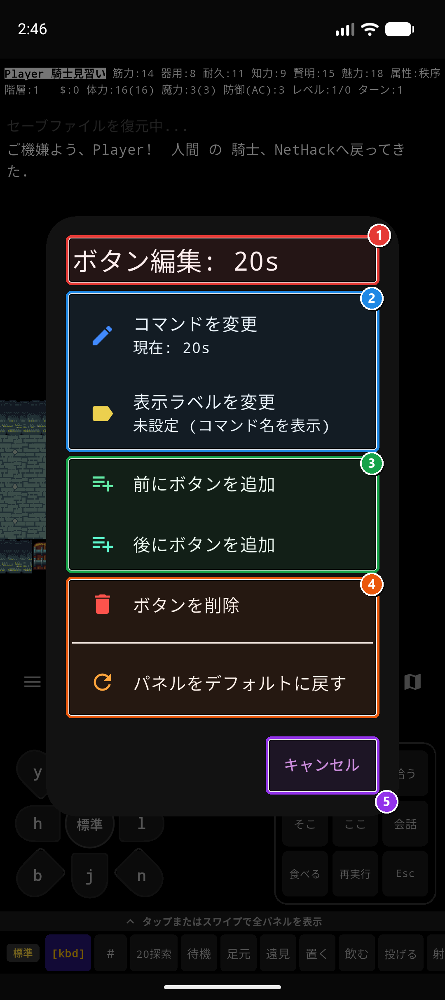
*図 3-3: コマンドパネルのボタンを長押しして開くボタン編集メニュー*

1. **編集対象ヘッダー**: 長押ししたボタンの現在割り当てられているコマンド（例：`ボタン編集: 20s`）を表示します。
2. **コマンド・ラベル変更**: 「コマンドを変更」で実行するキーやコマンド（例：`20s`, `w`, `#pray`）を書き換え、「表示ラベルを変更」でボタン上の表示名を変更できます（未設定時はコマンド名を表示）。
3. **ボタンの挿入**: 「前にボタンを追加」「後にボタンを追加」で、選択したボタンの前後へ新しいボタンを追加します。
4. **削除・初期化**: 「ボタンを削除」でそのボタンを取り除き、「パネルをデフォルトに戻す」で選択中のパネルを初期状態へリセットします。
5. **キャンセル**: 変更を行わずにダイアログを閉じます。

### ボタン表示形式の切り替え（コマンドそのまま表示）

「詳細ゲーム設定 → 操作コントローラ設定 → ボタン表示形式」（第14章）を **「コマンドをそのまま表示」** に設定すると、ボタン上のラベル名（「持ち物」「調べる」「20探索」など）ではなく、実際に送信される入力コマンド（`i`, `;`, `20s` など）がそのままボタンに表示されます。

NetHack のキー操作にすでに慣れている方にとっては、どのキーコマンドが送信されるか一目で分かるため、この設定の方が分かりやすく快適に操作できます。

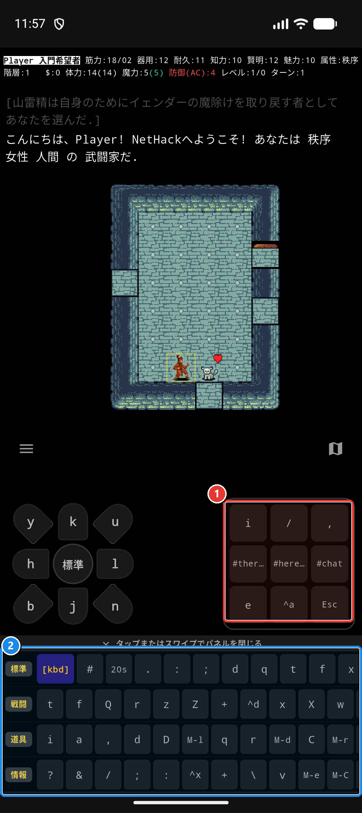
*図 3-4: 「コマンドをそのまま表示」に設定したときの 3×3 クイックショートカットとコマンドパネル*

1. **3×3 クイックショートカット（コマンド表記）**: 「持ち物」「調べる」「会話」などのラベルが、実際のキーコマンド（`i`, `/`, `,`, `#ther...`, `#chat`, `e`, `^a` 等）で表示されます。
2. **コマンドパネル（コマンド表記）**: 下部の各コマンドパネル上のボタンも、`20s`, `.`, `:`, `;`, `d`, `q` のようなコマンドそのままの表記に切り替わります。

---

## 4. 移動操作・マップタップ・全体マップ

### 移動モードの切り替え

8方向移動パッド中央のボタン（「標準」など）を**長押し**すると、「使用する移動モードの選択」ダイアログが開きます。ここで一時的な移動モードや常時オプション（`F`）を切り替えられます（中央ボタンを短くタップすると、有効化されている移動モードを順番に切り替えられます）。

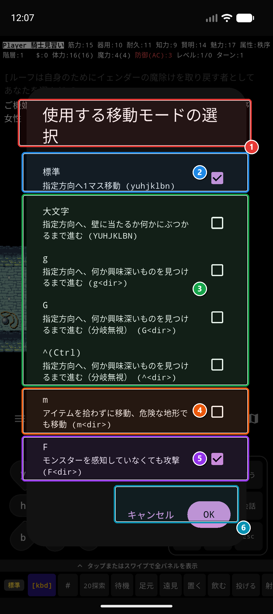
*図 4-1: 使用する移動モードの選択ダイアログ*

1. **ダイアログ見出し**: 使用する移動モードを選択する画面です。
2. **標準（1マス移動）**: `yuhjklbn` による通常の1歩移動に戻します。
3. **長距離移動系（大文字 / `g` / `G` / `^(Ctrl)`）**: 壁や扉にぶつかるまで走る **大文字 (`YUHJKLBN`)**、興味深いものが見つかるまで進む **`g<dir>`**（分岐で停止）、分岐を無視して進み続ける **`G<dir>` / `^<dir>`** の4種から選べます。
4. **`m` モード（`m<dir>`）**: 足元のアイテムを拾わずに移動したり、トラップや水・溶岩などの危険地形（自己責任）へ踏み込んだりしたいときに選びます。
5. **`F` モード（`F<dir>`）**: 見えていない・感知していないモンスターがいると思われる方向へ強制的に攻撃します（透明な敵や暗闇での戦闘に有効）。チェックを入れると設定が維持されます。
6. **キャンセル / OK**: 変更を確定して画面へ戻ります。

### マップの直接タップ操作（コンテキストメニュー）

ダンジョンマップ上のマスをタップすると、タップした場所（自分の足元・隣接8マス・離れた場所）に応じた行動メニューが自動で開きます。

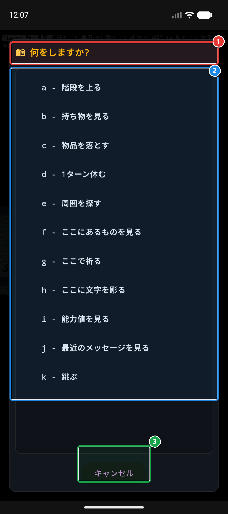
*図 4-2: 足元・周辺マスをタップしたときの行動メニュー例*

1. **メニュー見出し**: 選んだ位置に対して実行する行動の選択プロンプト（「何をしますか？」など）です。
2. **文脈に応じたアクション一覧**: 足元をタップ時は「階段を上る」「持ち物を見る」「周囲を探す」「ここで祈る」等、隣接マスをタップ時は「ここに移動する」や扉の開閉・攻撃・会話、離れたマスでは遠見やその方向への移動候補が提示されます。
3. **キャンセルボタン**: メニューを閉じてマップへ戻ります。

### 全体マップ表示

画面右側の半透明マップボタン（または `F9` / `Alt-z` キー）を押すと、現在の階層全体を見渡す「階層の全体地図」ダイアログが開きます。

*図 4-3: 現在の階層全体を確認できる全体地図ダイアログ*

1. **ヘッダーと閉じるボタン (`×`)**: 右上の `×` をタップするか、下のマップ領域外・Esc キーで閉じます。
2. **階層全体ビュー**: これまで探索して記憶している部屋・通路・階段・祭壇などの全体像が描画されます。ドラッグでスクロールできます。
3. **ピンチズーム案内**: 2本指でのピンチイン／ピンチアウトで全体図の拡大率を細かく調整できます。

---

## 5. ソフトキーボード・文字入力・拡張コマンド

### ソフトキーボード（フルキーボード）

コマンドパネル左側の `[kbd]` ボタンをタップすると、移動パッド＋ショートカットの代わりに英字フルキーボードが表示されます。アルファベットのコマンド（例：`q` 飲む、`r` 読む、`t` 投げるなど）を直接打ちたいときや、`Ctrl` 修飾が必要な操作に最適です。

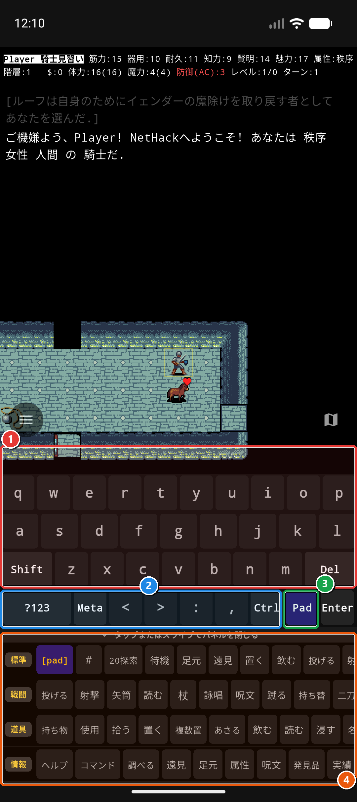
*図 5-1: ソフトキーボード表示（フルキーボード）*

1. **QWERTY キー配列部**: `q`〜`p` / `a`〜`l` / `z`〜`m` と `Shift`（大文字切替）、`Del` キーを配置しています。
2. **修飾・特殊記号バー**: `?123`（数字・記号パネル切替）、`Meta`（Alt/Meta 修飾：階段探索や全体マップ等）、`<`、`>`（上り階段・下り階段）、`:`（足元を見る）、`,`（拾う）、`Ctrl`（コントロール修飾：`Ctrl+x` 等）、`Enter` を素早く入力できます。
3. **`[Pad]` 切替ボタン**: タップするとソフトキーボードを閉じて、元の「8方向移動パッド＋3×3ショートカット」表示へ戻ります。
4. **コマンドパネル一覧**: キーボード展開中でも、標準・戦闘・道具・情報パネルの各コマンドを組み合わせて利用できます。

### 拡張コマンド（`#` コマンド一覧）

コマンドパネルの `#` をタップ（またはキーボードで `#` を入力）すると、すべての拡張コマンド一覧ダイアログが開きます。NetHack 特有の複雑なコマンドをうろ覚えのまま探せる強力な機能です。

*図 5-2: 日本語説明・絞り込み検索付きの拡張コマンドダイアログ*

1. **絞り込み検索欄**: コマンド名の一部（`adjust`, `pray`, `loot` 等）や説明キーワードを入力すると、候補をリアルタイムで絞り込めます。
2. **拡張コマンドリスト**: アルファベット記号（`a`, `b`, `c`...）と `#command` 名、および動作解説が表示されます。行をタップするだけで直接実行できます。
3. **キャンセルボタン**: 拡張コマンドを実行せずに閉じます。

---

## 6. アイテム操作メニューと名付け・文字入力プロンプト

### アイテム選択メニュー

持ち物一覧（`i`）や装備（`W`/`w`）、飲む（`q`）、読む（`r`）などのアイテム選択時には、タイル画像付きの分かりやすいカテゴリ分けメニューが表示されます。

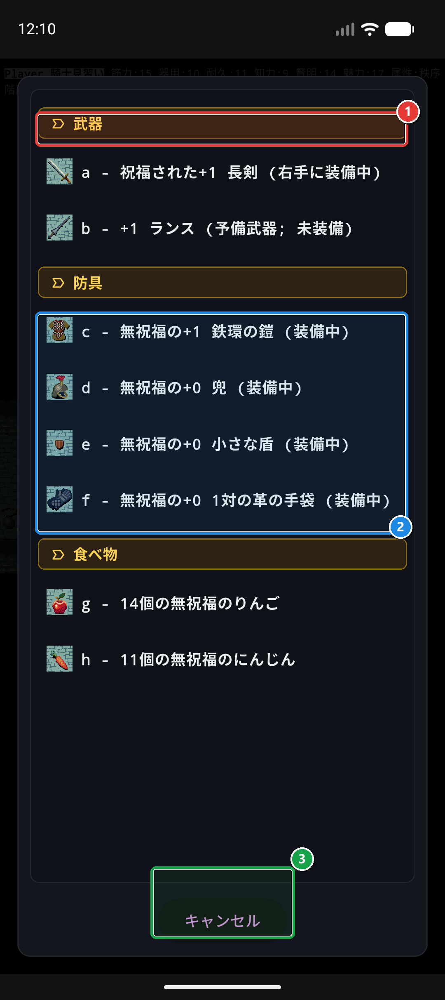
*図 6-1: 武器・防具・食べ物などカテゴリ分けされたアイテム選択メニュー*

1. **カテゴリ見出し**: 「武器」「防具」「食べ物」などのカテゴリ見出しが黄色い枠で区分けされ、目的のアイテムをすぐに見つけられます。
2. **アイテム行（アイコン＆状態カラー）**: 各行に割り当て文字（`a`, `b`, `c`...）とタイルアイコン、アイテム名、数量や装備状態（`右手に装備中` / `装備中` / `予備武器` など）が表示されます。祝福・無祝福・呪い状態が文字色で視認しやすくなっています。
3. **キャンセルボタン**: 選択を取り消してゲーム画面に戻ります。

### テキスト入力・名付けプロンプト

アイテムに名前を付ける（`#name` / `C`）ときや、願い事・階層の注釈・金額入力などでは専用のテキスト入力ダイアログが開きます。

*図 6-2: 直前メッセージ参照・入力履歴・バイト数表示付きの入力プロンプト*

1. **プロンプト質問見出し**: 何の入力を求められているか（例：「この六尺棒を何と名付けますか？」）が上部に大きく表示されます。
2. **直前の状況カード（タップで全履歴）**: 直前にゲーム画面へ出た関連ログを確認できるため、「何を識別して名付ける場面か」を見失いません。右上の「タップで全履歴 >」から過去ログ全体も確認できます。
3. **テキスト入力欄とバイト数カウンター**: OS の日本語入力（IME）を使ってそのまま入力できます。NetHack C コア側の制限に合わせた残バイト数（例：`0 / 62 バイト`）が表示され、全角英数字・記号は C コア側で自動正規化されます。
4. **履歴ボタン**: 過去に入力した文字列を呼び出して再入力できます。
5. **キャンセル / 決定ボタン**: 入力を確定して C コアへ送信するか、キャンセルします。

---

## 7. メッセージ履歴とスポイラー（攻略情報）

### メッセージ履歴の表示

画面上部のメッセージ領域をタップすると、これまでの冒険メッセージ履歴をさかのぼって確認できるボトムシートが開きます。

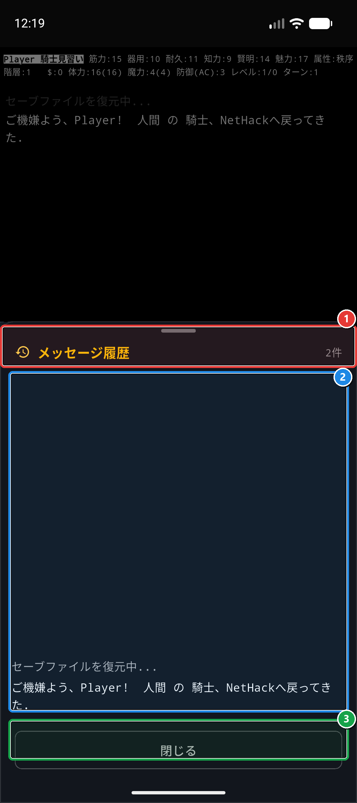
*図 7-1: 過去の冒険メッセージ一覧を表示するメッセージ履歴画面*

1. **履歴シートヘッダー**: 「メッセージ履歴」の見出しと操作ヒント（「タップまたは下スワイプで閉じる」）が表示されます。
2. **色分け済みメッセージログ**: 新しい・重要な警告（飢えやダメージ等）は強調色で表示され、スクロールして何ターンも前の状況を確認できます。
3. **閉じるボタン**: 下部の「閉じる」ボタンをタップするか、シートを下にスワイプするとメイン画面へ戻ります。

### スポイラー（攻略情報）ビューア

タイトル画面の本アイコン、またはゲーム中の「DartHack メニュー → スポイラーを読む」から攻略データベースを開けます。

*図 7-2: 検索・目次・画面一時確認に対応したスポイラービューア*

1. **ゲーム画面を一時確認（「覗き見」ボタン）**: タップで維持・長押しで一時透過することで、スポイラーを閉じずに背後のゲーム画面（マップやメッセージ）をそのまま覗き見ることができます。
2. **目次を開く**: 章ごとの目次モーダルを開き、読みたい攻略セクションへ一発でジャンプできます。
3. **スポイラー内を検索**: キーワード検索欄に調べたいアイテム名や用語を入力して、該当箇所をすぐ探せます。
4. **攻略本文エリア**: 読みやすく整形されたテキストやシンボル付きで攻略情報が表示されます。`ガイドブックを読む` でも同様のビューアが利用可能です。

---

## 8. DartHack メニュー（ドロワーメニュー）

左側の半透明メニューボタンをタップ（または画面左端から右スワイプ、キーボードの `Ctrl+M` / `F10`）すると、各種機能へアクセスできる「DartHack メニュー」が開きます。

*図 8-1: アプリ機能・ゲームコマンドへ素早くアクセスできるドロワーメニュー*

1. **メニューヘッダー**: 「DartHack メニュー」のタイトル領域です。
2. **セーブと終了操作**: **セーブして終了**（進行状況を保存して安全終了）と **セーブせず終了（放棄）**（セーブを残さず現在の冒険を破棄・確認ダイアログあり）が並びます。
3. **記録・ドキュメント閲覧**: **スコアボード**（第9章）、**ガイドブックを読む**（公式ルール解説）、**スポイラーを読む**（攻略データベース）、**マニュアルを読む**（本マニュアルをオフライン閲覧）を開きます。
4. **ゲーム補助コマンド・検索・画面切替**: **ヘルプを表示 (`?`)**、**データベース検索 (`/?`)**、**オプション設定 (`O`)**、**全体地図を表示 (`M-z`)** を直接呼び出せます。
5. **UI・アプリ設定**: **操作ボタンを非表示**（マップを広く見たいときにパッド等を一時非表示）と **ゲーム設定を開く**（詳細ゲーム設定画面へ移動）を実行します。

---

## 9. スコアボード・記録詳細・墓石表示

### スコアボードと今回の記録

冒険を終了（死去・昇天・脱出等）したとき、またはメニューから「スコアボード」を開いたときに、歴代ランキングが表示されます。

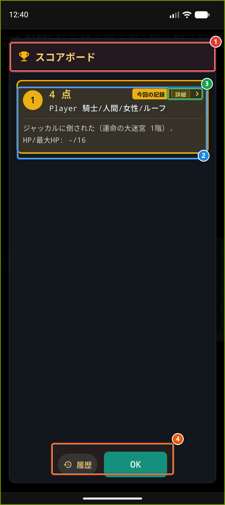
*図 9-1: カード形式で分かりやすく整形されたスコアボード画面*

1. **スコアボード見出し**: ランキング一覧画面のヘッダーです。
2. **ハイスコアカード（「今回の記録」ハイライト）**: 順位バッジ・合計点数・キャラクタープロフィール（名前/職種/種族/性別/信仰・守護神）・死因・到達階層・HP/最大HPがカードで表示されます。プレイ直後の自身の結果には黄色枠と「今回の記録 / Current Game」バッジが付きます。
3. **「詳細 >」ボタン**: 各カード右上の「詳細 >」をタップすると、そのプレイの詳細な統計情報（`xlogfile` 由来データ）を確認できます。
4. **履歴 / OK ボタン**: 「履歴」から終了直前ログを振り返ったり、「OK」でスコアボードを閉じて次へ進んだりできます。

### プレイ詳細と統計（xlogfile）

スコアボードの「詳細 >」をタップすると、冒険の記録と詳細統計が一覧表示されます。

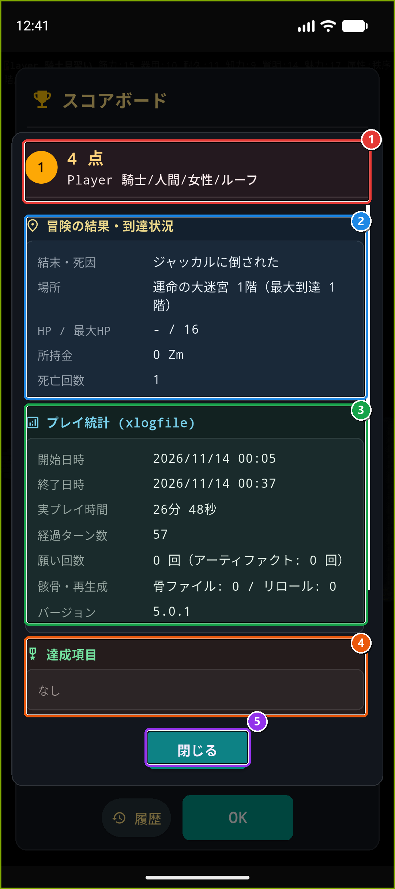
*図 9-2: 死因・到達状況・プレイ統計（xlogfile）・達成項目を確認できる詳細画面*

1. **選択エントリーサマリー**: 順位・スコア点数とキャラクターの基本情報です。
2. **冒険の結果・到達状況**: 結末（死因）・場所と最大到達階層・HP / 最大HP・所持金 (`Zm`)・これまでの死亡回数などを確認できます。
3. **プレイ統計 (`xlogfile`)**: 開始日時・終了日時・実プレイ時間・経過ターン数・願い回数（うちアーティファクト数）・骸骨ファイル（`bones`）およびリロール回数・NetHack バージョンを記録・表示します。
4. **達成項目**: ゲーム中に達成した各種実績・特別功績（Conduct 等）が表示されます。
5. **閉じるボタン**: スコアボード一覧へ戻ります。

### 死亡時の墓石画面

キャラクターが死亡すると、アスキー／ピクセルアートで描かれた墓石画面と追悼メッセージが表示されます。

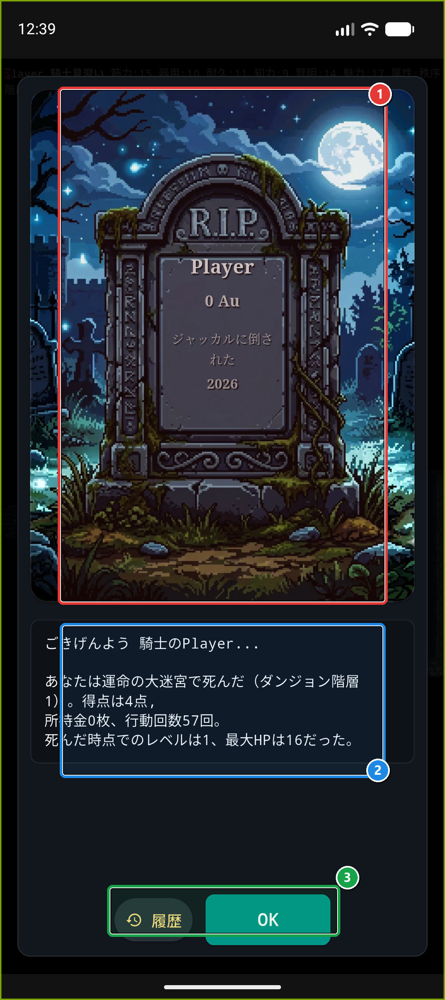
*図 9-3: R.I.P. ピクセルアートと追悼文が表示される墓石画面*

1. **墓石ピクセルアート（R.I.P. 碑文）**: キャラクター名・死因・亡くなった年が刻まれた墓石ビジュアルが表示されます。
2. **追悼サマリー文**: どこで何を残しどのように生涯を終えたかの要約メッセージです。
3. **確認ボタン（履歴 / OK）**: 「履歴」で最後のメッセージログを確認するか、「OK」をタップしてスコアボード表示へ進みます。

---

## 10. タイルセットの選択とカスタムタイルセット

タイトル画面の歯車アイコン、または「DartHack メニュー → ゲーム設定を開く」から **「詳細ゲーム設定」** 画面を開けます。先頭にある「タイル／シンボル設定」からタイル表示の ON/OFF と「タイルセットの選択」画面を開けます（ASCII 文字での古典的なプレイに切り替えたい場合はタイル表示を OFF にします）。

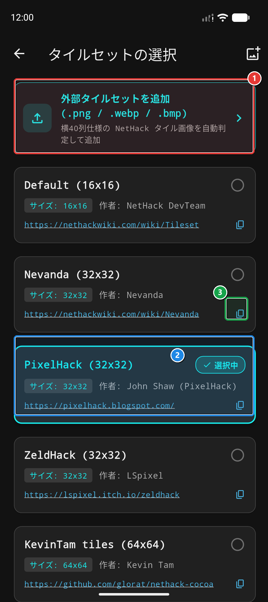
*図 10-1: 標準同梱タイルセットおよび外部カスタムタイルセットの管理画面*

1. **外部タイルセットを追加 (`.png` / `.webp` / `.bmp`)**: お使いの端末に保存されている NetHack 用スプライトシート画像を選択して追加できます。NetHack 標準の **横40列仕様（`画像横幅 ÷ 40`）** を自動判定し、非正方形タイル（例：`15x25` 等）も正確なアスペクト比で描画します。
2. **タイルセット一覧と現在選択中のカード**: 標準で複数の高品質タイルセットを同梱しています（デフォルトは `PixelHack (32x32)`）。各カードには解像度サイズ・作者名が明記され、現在適用中のセットには「選択中」バッジが表示されます。
3. **配布 URL コピーアイコン**: 各タイルセットの参照 URL 脇のアイコンをタップすると、配布元 URL をクリップボードへコピーできます。

### 同梱されている主なタイルセット

| タイルセット名 | 解像度 | 特徴 |
| :--- | :--- | :--- |
| **Default** | `16x16` | NetHack 本家標準のクラシックな小型タイル |
| **Nevanda** | `32x32` | 見やすく親しみやすいデザインの定番タイルセット |
| **PixelHack** | `32x32` | 視認性とドット絵の美しさを両立した初期選択タイル |
| **ZeldHack** | `32x32` | ファミコン風の色彩豊かなグラフィックタイル |
| **KevinTam tiles** | `64x64` | 高精細・透過背景対応（ダンジョンの床・地形の2層描画に対応） |

---

## 11. フォント・画面表示・ステータス・メッセージ領域設定

### フォント設定

*図 11-1: フォント設定（一括変更・サイズプリセット・マップフォント＆倍率）*

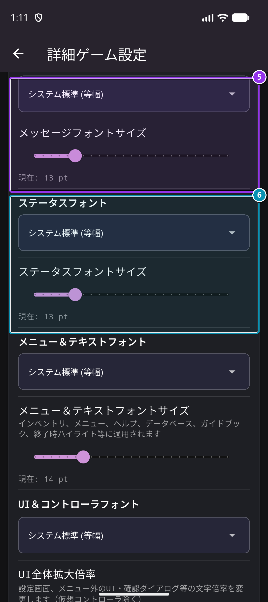
*図 11-2: フォント設定（メッセージ＆ステータスフォント・文字サイズ）*

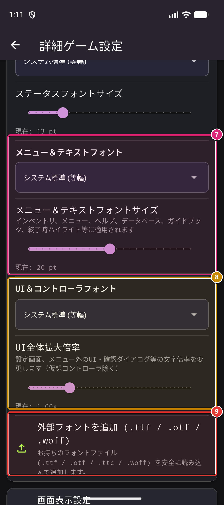
*図 11-3: フォント設定（メニュー＆テキスト・UI全体倍率・外部フォント追加）*

1. **フォント設定ヘッダー**: 画面各部およびアスキーマップのフォント・文字サイズをまとめて設定するセクションです。
2. **一括フォント変更**: マップ・メッセージ・ステータス・メニュー・UIの全5系統に同じフォントを一度に適用します。
3. **サイズ一括プリセット**: **標準**／**大きめ**／**特大** のボタンで、画面サイズや好みに合わせて全系統のフォントサイズ・倍率を一括調整できます。
4. **マップフォント＆アスキーマップ表示倍率**: タイル表示を OFF にした「ASCII マップ」描画時に使う専用フォント（デフォルト：`Terminus TTF (アスキー定番)`）と、ASCII マップの表示倍率（`1.0x` 等）を調整します。
5. **メッセージフォント＆メッセージフォントサイズ**: メッセージ領域のフォントと文字サイズ（pt）を設定します。
6. **ステータスフォント＆ステータスフォントサイズ**: ステータス領域のフォントと文字サイズ（pt）を設定します。
7. **メニュー＆テキストフォント＆サイズ**: インベントリ、メニュー、ヘルプ、データベース、ガイドブック、終了時ハイライト等に適用されるフォントと文字サイズ（pt）を設定します。
8. **UI＆コントローラフォント＆UI全体拡大倍率**: 設定画面、メニュー外のUI・確認ダイアログ等のフォントおよび文字倍率（仮想コントローラ除く）を調整します。
9. **外部フォントを追加・管理**: 端末内の `.ttf` / `.otf` / `.ttc` / `.woff` ファイルを読み込んでカスタムフォントとして追加・管理できます。

### 画面表示設定（画面モード・物理キーヘルプ・カメラ追従）

*図 11-4: 画面モード・物理キーボード用ヘルプ・カメラ追従モード設定*

1. **画面表示設定ヘッダー**: 画面モードとカメラ追従方法を設定するセクションです。
2. **画面モード選択**: 通常表示や全画面表示などの画面モードを選びます。
3. **物理キーボード用ヘルプを有効化**: ON にするとボタン上にショートカット文字（`y:`, `n:`, `Esc:` 等）が表示され、`F1` または `M-h (Alt-h)` で操作ヘルプダイアログを開けるようになります。
4. **カメラ追従モード**: 移動ごとに主人公を画面見やすい位置に保つ **常時センタリング（主人公追従）** と、PC 版のように画面端へ近づいたときだけスクロールする **マップ固定モード（端スクロール）** を切り替えます。
5. **スクロールマージン＆スクロール量**: 「マップ固定モード」を選択している場合に有効になり、端から何マス手前でスクロールを開始するか（スクロールマージン）と、1回のスクロールで何マス移動させるか（スクロール量）を調整できます。

### ステータス領域設定

*図 11-5: ステータス表示エリアの表示モード・行数・HPバー・状態強調設定*

1. **ステータス領域設定ヘッダー**: タップでセクションを展開／折りたたみできます。
2. **ステータス領域表示モード**: 画面幅に合わせて文字を自動縮小する「自動縮小フィット」などの表示方法を選択します。
3. **ステータス行数・構成**: 1行〜3行（超コンパクトは最小項目のみ）など、画面の縦スペースに応じてステータス行の構成を切り替えます。
4. **HPバー表示 (`hitpointbar`)**: ON にするとキャラクター名と職業の背景に現在のHP残量ゲージを重ねて表示します。
5. **ステータス強調・経過ターン・経験値表示等**: HP や状態異常の色分け強調（`hilite_status`）、経過ターン（`time`）、経験値（`showexp`）、装備中の武器・防具表示などを切り替えられます（※文字サイズの変更は「フォント設定」に集約されました）。

### メッセージ領域設定

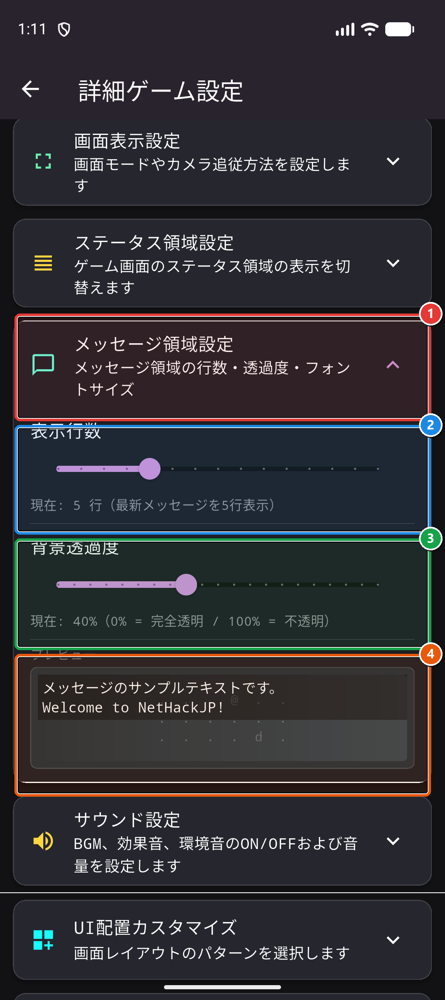
*図 11-6: メッセージ領域の表示行数・背景透過度・プレビュー*

1. **メッセージ領域設定ヘッダー**: タップでメッセージ領域設定を展開／折りたたみできます。
2. **表示行数**: マップ上部に表示する最新メッセージの行数（1〜15行）をスライダーで調整します。
3. **背景透過度**: メッセージ領域背景の不透明度（`0%`＝完全透明〜`100%`＝不透明）を調整し、背後のマップの見やすさと文字の視認性のバランスをとれます。
4. **リアルタイムプレビュー**: 上記の行数・透過度および「フォント設定」で指定したメッセージフォント・文字サイズの見た目をその場で確認できます。

---

## 12. サウンド設定

*図 12-1: サウンド全体・BGM・効果音(SE)・環境音の設定画面*

1. **サウンド設定ヘッダー**: BGM・効果音・環境音の ON/OFF や音量を調整するセクションです。
2. **サウンド全体・BGM スイッチ**: 「サウンド全体」ですべての音声出力を一括ミュート／有効化できます。その下にある「BGM」スイッチでダンジョン層・特殊部屋に応じたBGM再生を個別に切り替えられます。
3. **BGM音量・効果音（SE）・環境音**: スライダーで BGM や各種音声バランスを細かく調整し、戦闘・扉開閉・環境音（祭壇・お店・水辺など）を好みに合わせて切り替えられます。

---

## 13. UI配置カスタマイズとタブレット対応

### レイアウトパターンと左右入替設定

手の大きさや持ち方、端末の向きに合わせて、操作 UI の上下関係や左右配置を変更できます。

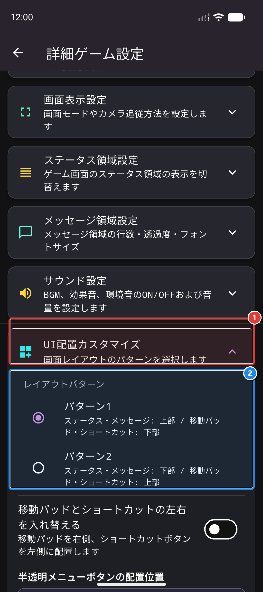
*図 13-1: 画面レイアウトパターン1／2 の切替画面*

1. **UI配置カスタマイズヘッダー**: 画面レイアウトの構成を変更するセクションです。
2. **レイアウトパターン選択**: **パターン1**（上=ステータス・メッセージ / 中央=マップ / 下=移動パッド・ショートカット）と **パターン2**（上下反転）を切り替えます。さらに下には「移動パッドとショートカットの左右を入れ替える」「半透明メニューボタンの配置位置」オプションもあります。

### 横画面・タブレット端末での表示比較

タブレット端末や大画面の横向き表示では、ワイド画面を活かして広大なダンジョン領域と全表示に近いワイドコマンドパネルが自動的に最適化されます。

*図 13-2: 大画面タブレット横向き（1920x1200 等）でのプレイ画面*

1. **上部ステータス＆メッセージ領域**: 横長レイアウトによりステータス項目が1〜2行にすっきり収まり、メッセージもゆったり表示されます。
2. **広域マップエリア＋左右ボタン**: 横幅いっぱいに広いダンジョン領域が確保され、左右端に半透明メニューボタンと全体マップボタンが干渉せず配置されます。
3. **左下 8方向移動パッド**: 左手親指が届きやすい左下に配置されます。
4. **右下 3×3 クイックショートカット**: 右手親指で素早く押せる右下に配置されます。
5. **最下部ワイドコマンドパネル**: 多数のコマンドボタンがスクロール不要に近い横幅で並び、拡張操作にすぐアクセスできます。

---

## 14. 操作コントローラ設定

詳細ゲーム設定の **「操作コントローラ設定」** では、ボタンの表示形式・透明度・サイズ倍率・長押しやマップタップ時の移動動作・PC／外部マウス接続時の操作割り当て・ドロワーメニューの引き出し位置などを細かく調整できます。

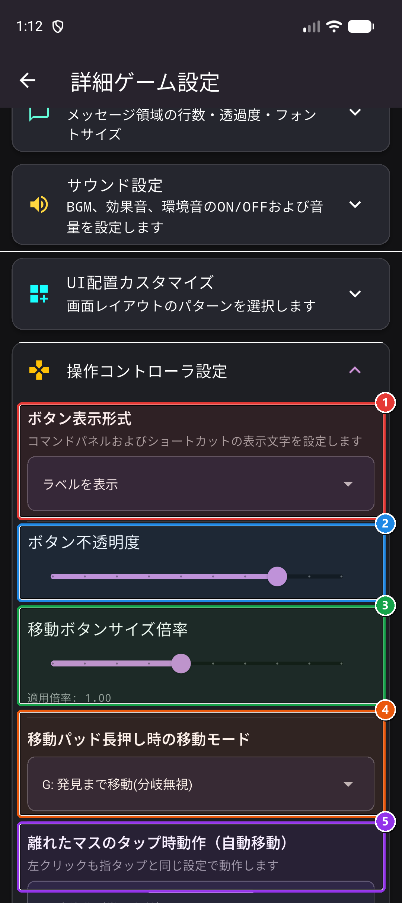
*図 14-1: 操作コントローラ設定（表示形式・透明度・移動パッド・自動移動）*

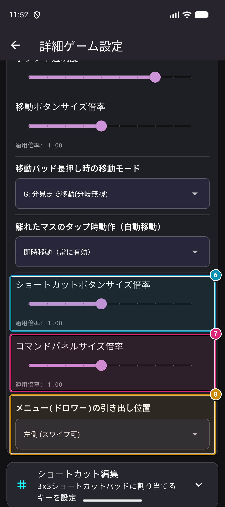
*図 14-2: 操作コントローラ設定（マウス操作設定：右クリック・ホイール・中ボタン）*

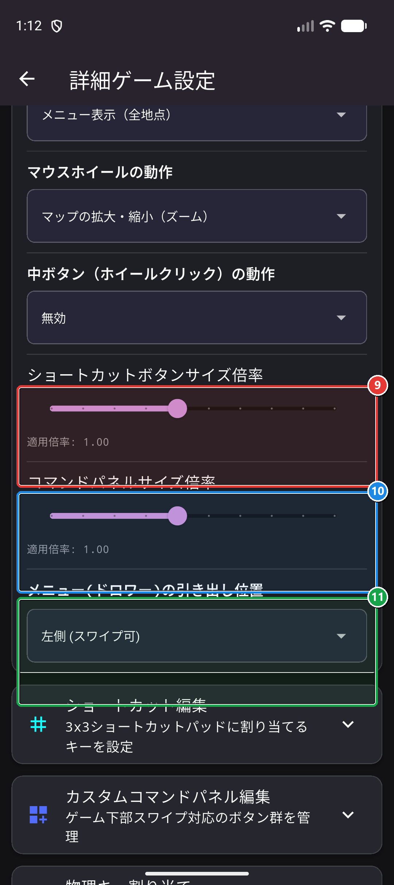
*図 14-3: 操作コントローラ設定（ショートカット・コマンドパネル倍率・ドロワー位置）*

1. **ボタン表示形式**: コマンドパネルおよび 3×3 クイックショートカットの文字を **「ラベルを表示」**（標準）または **「コマンドをそのまま表示」**（`i`, `;`, `20s` 等のキー表記。NetHack のキー操作に慣れた方向け）から選択します。
2. **ボタン不透明度**: 8方向移動パッド・3×3 クイックショートカット・各種ボタンの透明度をスライダーで調整します（`0.1`〜`1.0`）。
3. **移動ボタンサイズ倍率**: 8方向移動パッドの大きさを `0.6`〜`1.5` 倍の範囲で調整します（画面幅に応じた自動上限の適用倍率も下に表示されます）。
4. **移動パッド長押し時の移動モード**: 8方向移動パッドの方向キーを長押ししたときに使用する移動モード（通常移動・大文字走行・`g`・`G`・`^`・`m`・`F`）を指定します。
5. **離れたマスのタップ時動作（自動移動）**: マップ上の離れたマスをタップした際の移動挙動（メニュー表示／即時移動（常に有効）／画面スクロール後のみ有効／無効）を設定します。マウスの左クリックも指タップと同じ設定で動作します。
6. **右クリック時の動作**: マウス接続時の右クリック動作を **メニュー表示（全地点）**／**スマート移動（安全確認付き）**／**直接アクション（確認なしで即時実行）**／**無効** から選択します。
7. **マウスホイールの動作**: ホイール回転時の動作を **マップの拡大・縮小（ズーム）**／**マップのスクロール移動**／**無効** から選択します。
8. **中ボタン（ホイールクリック）の動作**: ホイールクリック時の動作を **無効**／**メニュー表示（全地点）**／**スマート移動**／**直接アクション** から選択します。
9. **ショートカットボタンサイズ倍率**: 3×3 クイックショートカットの大きさを `0.6`〜`1.5` 倍の範囲で調整します。
10. **コマンドパネルサイズ倍率**: 画面下部のコマンドパネルのボタンサイズを `0.6`〜`1.5` 倍の範囲で調整します。
11. **メニュー（ドロワー）の引き出し位置**: DartHack メニューを開く方向・スワイプ端を **左側（スワイプ可）**／**右側**／**上側**／**下側** から選択します。

---

## 15. コマンドパネル・クイックボタンの編集

ゲーム画面最下部のコマンドパネル群は、プレイヤー自身のプレイスタイルに合わせて自由に追加・編集・並べ替えを行えます。

*図 15-1: コマンドパネルの一覧管理・編集・新規追加・リセット画面*

1. **パネル名を表示トグル**: 各コマンドパネル行の左端に「標準」「戦闘」「道具」「情報」などの名前バッジを表示するかどうかを切り替えます（非表示にすると横幅をより広く使えます）。
2. **登録済みパネル一覧（編集／削除アイコン）**: 各パネルのタイトルと先頭コマンド一覧が表示されます。右側の **鉛筆アイコン** で中のボタン名・送信コマンド・順序を編集でき、**ゴミ箱アイコン** でカスタムパネルを削除できます。
3. **新しいコマンドパネルを追加**: オリジナルのコマンドパネルを作成します（最大 7 個まで登録可能）。魔法使い用の呪文ショートカット集や、よく使う `#` 拡張コマンドだけを並べたパネルなどを作れます。
4. **パネル設定をデフォルトに戻す**: カスタマイズ内容を初期化し、標準・戦闘・道具・情報の初期構成へ戻します。

> [!TIP]
> 3×3 クイックショートカットについても、「詳細ゲーム設定」の **「クイックショートカット設定」** から9マスのボタン内容を個別に編集できます。また、メインゲーム画面上でも、コマンドパネルの各ボタンや 3×3 クイックショートカットのボタンを**長押し**することで、その場ですぐにキーやラベルを編集できます（第3章「コマンドパネルの長押しカスタマイズ」参照）。

---

## 16. 物理キーボード操作ガイドと物理キー割り当て

### 物理キーボード接続時のショートカット操作

Bluetooth キーボードや Chromebook・PC・USB キーボードを接続している場合、NetHack 標準キーに加えて DartHack UI 専用の便利ショートカットキーを使用できます。設定画面の **「詳細ゲーム設定 → 画面表示設定 → 物理キーボード用ヘルプを有効化」** をオンにしている場合、`F1` または `Alt-h (M-h)` キーを押すといつでも操作ガイドを表示できます。

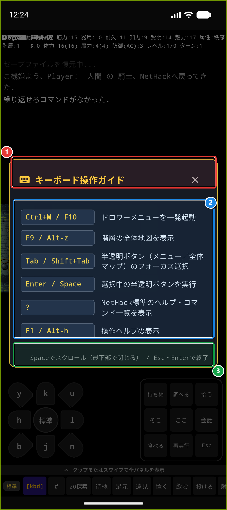
*図 16-1: 物理キーボード用ショートカット操作ガイド*

1. **操作ガイドヘッダーと閉じるボタン (`×`)**: `F1` または `Alt-h` で開くガイド画面です。
2. **UI 専用ショートカットキー一覧**: `Ctrl+M` / `F10`（ドロワーメニュー一発起動）、`F9` / `Alt-z`（全体地図）、`Tab` / `Shift+Tab`（半透明ボタンのフォーカス移動）、`Enter` / `Space`（選択中の半透明ボタンを実行）、`?`（NetHack 標準ヘルプ）、`F1` / `Alt-h`（操作ヘルプ）が使えます。
3. **下部の操作案内**: `Space` で下へスクロール（最下部でもう一度押すと閉じる）、`Esc` または `Enter` で即座に終了します。

### 物理キー割り当て（音量ボタン・戻るボタン）

キーボードが無い端末でも、本体側面の **音量ボタン** や Android の **戻るボタン／ジェスチャー** に任意の NetHack コマンド（`s` 探索、`.` 休息、`Esc` キャンセル等）を割り当てられます。

*図 16-2: 音量アップ／ダウンキー・戻るボタンのコマンド割り当て設定*

1. **物理キー割り当てヘッダー**: 本体ハードウェアキーの挙動を設定するセクションです。
2. **音量アップキー**: 音量＋ボタンに割り当てるコマンドを選びます（初期値：`機能なし（通常音量変化）`）。
3. **音量ダウンキー**: 音量－ボタンに割り当てるコマンドを選びます（初期値：`機能なし（通常音量変化）`）。
4. **戻るボタン**: 戻る操作にコマンドや確認動作を割り当てます（初期値：`機能なし（通常通りアプリを閉じる）`）。誤バックによる中断を防ぎたい場合は割り当て変更が便利です。

---

## 17. ゲームルールとハードモード・縛りプレイ

`defaults.nh` に連動するゲーム本体の各種プレイ設定や、熟練者向けの制限プレイ（縛りプレイ / Challenges）をトグル操作だけで簡単に設定できます。

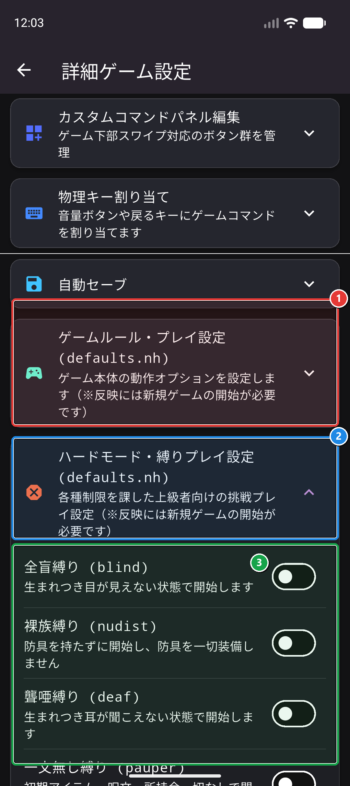
*図 17-1: ゲームルール設定とハードモード・縛りプレイトグル一覧*

1. **ゲームルール・プレイ設定 (`defaults.nh`)**: 自動拾い（`autopickup`）・時間表示・確認プロンプトなど、NetHack 本体の標準動作オプションを設定できます（※変更の反映には **新規ゲームの開始** が必要です）。
2. **ハードモード・縛りプレイ設定 (`defaults.nh`) ヘッダー**: 上級者向けの挑戦プレイ設定セクションです（※反映には **新規ゲームの開始** が必要です）。
3. **縛りプレイ・チャレンジ項目**: **全盲縛り (`blind`)**、**裸族縛り (`nudist`)**、**聾唖縛り (`deaf`)**、**一文無し縛り (`pauper`)** など各種制限をトグルで ON/OFF できます（下にスクロールするとさらに多くのチャレンジ設定が表示されます）。

---

## 18. 高度な設定（defaults.nh 編集と設定のバックアップ）

設定画面の最下部には、NetHack 上級者向けのオプションファイル直接編集と、端末間でカスタマイズを引き継ぐエクスポート／インポート機能があります。

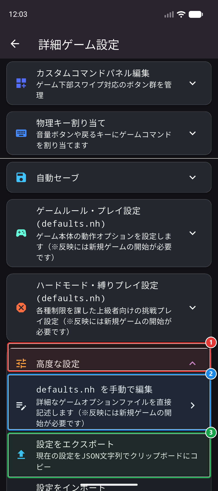
*図 18-1: defaults.nh 直接編集および設定エクスポート／インポート*

1. **高度な設定ヘッダー**: 上級者向けの設定管理セクションです。
2. **`defaults.nh` を手動で編集**: UI トグルにない細かな NetHack オプション（メニューカラー設定、ステータス強調ルール、`OPTIONS=...` のカスタム記述など）をテキストエディタで直接編集できます（※編集内容の反映には **新規ゲームの開始** が必要です）。
3. **設定をエクスポート／インポート**: **設定をエクスポート** で現在のフォント・UI配置・カスタムコマンドパネル・ショートカット・表示設定を JSON 文字列としてクリップボードにコピーでき、その下の **設定をインポート** で貼り付けて別端末や再インストール後に瞬時に復元できます。

---

## 付録 A. 日英両対応入力ガイド（通常プレイ）

日本語モード（NetHackJP コア）では、ゲーム内の各種入力ダイアログ（第6章）や対話プロンプトにおいて、英語（ASCII）だけでなく自然な日本語（ひらがな・カタカナ・漢字・全角英数字）での入力にネイティブ対応しています。全角の英数字や記号は C コア側で自動的に半角へ正規化されて処理されます。

### A.1 願い (Wish)

魔法のランプ、願いの杖、玉座などで「何をお望みですか？」と問われた際の入力です。

| 項目 | 日本語入力の例 | 英語入力の例 |
| :--- | :--- | :--- |
| **防具・装飾品** | `祝福された+2灰色ドラゴンの鱗鎧` / `耐毒の魔除け` / `スピードブーツ`（または `スピードの靴`） | `blessed +2 gray dragon scale mail` / `amulet versus poison` / `speed boots` |
| **道具・ツール** | `祝福された魔法のマーカー` / `ユニコーンの角` | `blessed magic marker` / `unicorn horn` |
| **複数個のアイテム** | `7本のろうそく` / `20本の銀の矢` / `2本の充填の巻物` | `7 candles` / `20 silver arrows` / `2 scrolls of charging` |
| **特殊な状態** | `グレーター・デーモンの死体` / `点灯した真鍮のランタン` / `金の小像` | `corpse of greater demon` / `lit brass lantern` / `gold figurine` |

> [!IMPORTANT]
> **願いの仕様・個数制限についての重要事項**
> NetHack の通常プレイにおける「願い」では、アイテムのカテゴリによって**入手できる数量に厳格な制限**があります。
> - **スタックできないアイテム（道具・武器・防具・杖など）**: 魔法のマーカー、剣、鎧などは、どれほど大きな数字（例: 「7個の魔法のマーカー」）を指定して願っても、**必ず1個しか手に入りません**。チャージ数や耐久度の最大値を狙う場合は、数量ではなく `祝福された魔法のマーカー` のように祝福状態を指定するのが現実的です。
> - **ろうそく**: 最大で **7個** まで（イェンダーの祈祷の儀式に必要な個数）。
> - **投射武器・弾薬・石（矢、ダーツ、スリングの石等）**: 最大で **20個** まで。
> - **巻物・ポーション・食料など**: ランダム制限（`d.cnt < rnd(6)`）が適用されるため、通常は **2〜3個** が上限となります。

> [!TIP]
> **願いの文法ヘルプ画面**
> 「何をお望みですか？」の入力プロンプトで日本語の `ヘルプ`（または `たすけて`）、英語の `help`（または `?`）を入力すると、願いの書き方や指定できるキーワードのヘルプ画面をいつでも参照できます（願いの機会は消費されません）。

### A.2 虐殺 (Genocide)

虐殺の巻物を読んだ際などに「何を虐殺しますか?」と問われた時の入力です。

| 指定タイプ | 日本語入力の例 | 英語入力の例 | 補足 |
| :--- | :--- | :--- | :--- |
| **単体虐殺（種族名）** | `マスター・リッチ` / `銀色ドラゴン` / `マインド・フレア` | `master lich` / `silver dragon` / `mind flayer` | 指定した特定のモンスター種族を根絶します。 |
| **クラス虐殺（シンボル記号）** | `L` / `h` / `;` | `L` / `h` / `;` | 祝福された虐殺の巻物で、そのシンボルに属するモンスター群を一括虐殺します。 |
| **虐殺の拒否（誓いの維持）** | `none` / `nothing` / `なし` / 空のまま決定 | `none` / `nothing` / empty string | 不虐殺の誓い（Genocide conduct）を継続する場合、これらを入力して虐殺を安全に辞退できます。 |

### A.3 自己変身 (Polymorph)

「自己変身の制御（Polymorph control）」能力を持った状態で変身の罠を踏んだり、変身の薬・杖・魔法を使った際の入力です。

| 指定タイプ | 日本語入力の例 | 英語入力の例 | 補足 |
| :--- | :--- | :--- | :--- |
| **モンスター種族名** | `銀色ドラゴン` / `マスター・リッチ` / `吸血鬼の貴族` | `silver dragon` / `master lich` / `vampire lord` | 任意の通常モンスターを指定して変身します。 |
| **モンスタークラス名** | `ドラゴン` / `オーク` | `dragon` / `orc` | 種族ではなく大分類名を指定した場合、そのクラスの中からランダムに変身します。 |
| **ランダム指定** | `ランダム` または `*` | `random` または `*` | 制御変身を放棄し、完全ランダムに変身します。 |
| **変身の中止** | キャンセルボタン / `Esc` | Cancel / `ESC` key | 変身をキャンセルします。 |

### A.4 魔法のマーカーでの書き込み (Write)

魔法のマーカーを使用（`a` または `#apply`）して、白紙の巻物や白紙の魔法書（呪文書）に文字を書き込む際の入力です。

| 対象 | 日本語入力の例 | 英語入力の例 | 補足 |
| :--- | :--- | :--- | :--- |
| **巻物の正式名** | `識別` / `識別の巻物` / `解呪` / `虐殺` / `鑑定`（JNetHack互換） | `identify` / `scroll of identify` / `remove curse` / `genocide` | すでに識別済みの巻物を書き込みます。「〜の巻物」を省いた名前や JNetHack 慣用句でも認識します。 |
| **巻物の未識別ラベル** | `コンテキスト・スイッチ` / `アンドロメダの銀河` | `ELBIB YLOH` / `TEMOV` | 現在のゲームでそのラベルに割り当てられている巻物が書き込まれます。 |
| **巻物のプレイヤー呼称** | `ふつうの巻物`（名付けた call 名） | `scroll called plain` | プレイヤーが `#name` で種類に付けた呼称（call 名）でも指定可能です。 |
| **魔法書（呪文書）** | `魔力の矢の呪文書` / `解呪の魔法書` / `穴掘り` | `spellbook of force bolt` / `remove curse` / `dig` | 「呪文書」「魔法書」どちらでも認識します（未識別外見ラベルでの書き込みは不可）。 |

### A.5 階層テレポート (Level Teleport)

階層テレポートの巻物、トラップ、または能力を使用して別の階層へ移動する際の入力です。

| 指定タイプ | 日本語入力の例 | 英語入力の例 | 補足 |
| :--- | :--- | :--- | :--- |
| **絶対階層指定** | `5`（現在ダンジョンの5階へ） | `5` | 単純な数値を入力すると、その深さの階層へジャンプします。 |
| **相対階層指定** | `+2`（2階下へ） / `-1`（1階上へ） | `+2` / `-1` | 符号付き数値を入力すると、現在階からの相対移動となります。 |
| **方向・ランダム記号** | `>`（下の階へ） / `<`（上の階へ） / `*`（ランダム階層へ） | `>` / `<` / `*` | 階段と同じ記号で直前・直後の階へ、`*` でランダム階層へ移動します。 |
| **特殊階層・ブランチ名** | `鉱山` / `ノームの鉱山` / `倉庫番` / `神託所` / `デルフィ` / `城` / `死者の谷` | `mines` / `sokoban` / `oracle` / `delphi` / `castle` / `valley` | **同一ブランチ内で過去に訪問済みの階層・分岐**を指定できます（通常プレイでは未訪問階層へは飛べません）。 |
| **プレイヤーのカスタム注釈** | `拠点` / `寺院` / `ショップ` | `stash` / `temple` / `shops` | `#annotate`（情報パネルの「注釈」）で設定した注釈名を指定して、その階層へ直接テレポートできます。 |

### A.6 金庫番からの誰何・名乗り (Vault Guard Challenge)

迷宮内の宝物庫（Vault）にテレポートなどで侵入した際、番兵（金庫番）が現れて「見知らぬ者よ、名を名乗れ. -」と問いかけてきた時の名乗り入力です。

| 名乗り | 日本語入力の例 | 英語入力の例 | 結果・効果 |
| :--- | :--- | :--- | :--- |
| **金庫番を欺く合言葉** | `クロイソス` / `クレオソート` | `Croesus` / `Kroisos` / `Creosote` | 大富豪クロイソス本人、またはパロディキャラクターの名を名乗ると、金庫番は騙されて会釈し平和裏に立ち去ります。 |
| **自分の名前** | （キャラクター作成時の名前） | (Player character name) | 自分の正規の名前を名乗ると、金庫番から宝物庫の外へ退去するよう先導されます。 |
| **その他・偽名** | （適当な名前や嘘の名前） | (Any fake name) | 金庫番を欺けず、先導または敵対行動に移ります。秩序属性キャラが自分以外の名前を答えると「嘘つき（Liar!）」とみなされ、**アライメント値が -1** になります。 |

### A.7 アイテムへの名前付け・呼称 (Name / Call)

`#name`（`C` または道具パネルの「名付け」）コマンドを使用して、アイテムに個別の名前や種類ごとの呼称を設定する際の入力です。

| 対象 | 日本語入力の例 | 英語入力の例 | 補足 |
| :--- | :--- | :--- | :--- |
| **個別アイテムへの命名** | `エクスカリバー` / `スティング` / `愛刀` | `Excalibur` / `Sting` / `MyBlade` | 特定の武器や防具に名前を付けます。条件を満たしていれば特定のアーティファクトへ昇格します。 |
| **未識別アイテム種類への呼称** | `ふつうの指輪` / `透明薬` / `しびれ薬` | `plain ring` / `invis` / `paralysis` | まだ正式識別されていないアイテムの種別全体にメモとしての名前を付けます。 |

### A.8 モンスターへの命名 (Name Monster)

`#name`（`C`）コマンドでモンスターを指定し、個別の名前を付ける際の入力です。

| 対象 | 日本語入力の例 | 英語入力の例 | 補足 |
| :--- | :--- | :--- | :--- |
| **ペット・モンスター** | `ポチ` / `タマ` / `頼れる相棒` | `Rover` / `Spot` / `Buddy` | ペットに名前を付けると愛着が湧くだけでなく、ログやメッセージでの判別が容易になります。 |

### A.9 地面への刻印 (Engrave)

`#engrave`（標準パネルの「刻む」/`E`）コマンドを使用して、床に文字を書き込む際の入力です。

| 刻印内容 | 日本語入力の例 | 英語入力の例 | 効果 |
| :--- | :--- | :--- | :--- |
| **魔除けの言葉** | `Elbereth` / `エルベレス` | `Elbereth` | この文字が刻まれたマスの上にいる間、特定のモンスター（人間、天使、悪魔、一部アンデッド等を除く）はプレイヤーを直接物理攻撃できず逃走します。 |
| **自由メッセージ** | `ここに荷物を置く` / `←下り階段` | `Stash here` / `Stairs left` | 自由なメモやメッセージを床に残すことができます。 |

### A.10 ダンジョン階層メモ (Annotate)

`#annotate`（情報パネルの「注釈」）コマンドを使用して、現在のダンジョン階層に注釈（アノテーション）を記録する際の入力です。

| メモ内容 | 日本語入力の例 | 英語入力の例 | 補足 |
| :--- | :--- | :--- | :--- |
| **階層アノテーション** | `拠点` / `寺院（祭壇あり）` / `ショップ4軒` / `大部屋` | `stash` / `temple` / `shops` / `bigroom` | 記録した注釈は `#overview`（「迷宮概要」）で確認できるほか、階層テレポートの移動先としても認識されます。 |

### A.11 図鑑・画面上の調査 (Whatis)

`/`（3×3 ショートカット「調べる」）、`;`（標準パネル「遠見」）、または DartHack メニューの「データベース検索 (`/?`)」で呼び出されるデータベース検索です。

| 検索対象 | 日本語入力の例 | 英語入力の例 | 補足 |
| :--- | :--- | :--- | :--- |
| **記号または用語** | `@` / `d` / `銀色ドラゴン` / `エルベレス` | `@` / `d` / `silver dragon` / `Elbereth` | シンボル文字（1字）やモンスター名・用語を入力して、対応する解説や公式マニュアルの項目を参照します。 |

### A.12 メニュー・所持品の絞り込み検索

所持品インベントリ画面や各種選択メニューにおいて、`/` キーや絞り込み機能でフィルタをかける際の入力です。

| 検索語 | 日本語入力の例 | 英語入力の例 | 補足 |
| :--- | :--- | :--- | :--- |
| **フィルタ文字列** | `回復` / `銀` / `ポーション` / `巻物` | `heal` / `silver` / `potion` / `scroll` | 入力した文字列を含むアイテムや選択肢のみが即座に絞り込まれて表示されます。 |

### A.13 キャラクター作成時の名前入力

ゲーム開始時、「お名前は？」ダイアログで主人公キャラクターの名前を決定する入力です（第2章参照）。

- **入力例**: `風来のシレン`, `アリス`, `武蔵`, `Shiren`, `Alice`
- 漢字・ひらがな・カタカナ・英数字いずれもフルサポートされています（UTF-8 で最大 31 バイトまで）。

### A.14 神殿・祭壇への寄進・奉納金 (Donate / Bribe)

寺院の神官（僧侶）に話しかけたり、特定の悪魔への賄賂の際に金額を入力するプロンプトです（例: `いくら寄進しますか?`）。

- **入力例**: `400`, `５００`, `1000`
- 全角数字（`５００` など）を入力した場合でも自動的に半角に正規化されて正しく認識されます（全角入力による 0 判定で神官が激怒する誤動作が防止されています）。
- キャンセルボタン、`Esc`、または物理キーボードの `ESC` キーで寄進を取りやめることができます。

### A.15 城の跳ね橋の開閉旋律 (Gear Melody / Pass-tune)

ホルンや木製フルートなどの楽器を適用（`a` または `#apply`）して城の跳ね橋を開閉する合言葉旋律（5音の音列）を入力するシーンです。

- **入力例**: `ABCDE`, `ｃｄｅｆｇ`, `ＡＢＣＤＥ`
- A〜G の音列を大文字・小文字、半角・全角問わず入力可能です。

### A.16 危険行動の確認 (Paranoid Confirm)

`paranoid_confirmation` 設定が有効な環境で、水没・溶岩への進入、攻撃、アイテムの破壊など危険な行動を行う際に要求される確認プロンプトです（例: `本当に〜しますか? [yes/no]`）。

- **肯定の入力例**: `yes`, `ｙｅｓ`, `はい`
- **否定・中止の入力例**: `no`, `ｎｏ`, `いいえ`, `やめる`, `中止`、キャンセル、`Esc`、または空のまま決定
- 誤操作による死亡を防ぐため、完全な単語入力のみを肯定として受け付け、全角や日本語の「はい」も安全に利用できます。

### A.17 所持品アイテムの文字選択 (Inventory Selection)

所持品から使用するアイテムを選ぶ際、文字（アルファベット）を入力するプロンプトです（例: `どれを選択しますか? [a-z]`）。

- **入力例**: `a`, `ｂ`, `ｍ`（メニュー表示）, `？`（一覧表示）
- 全角アルファベットや全角記号（`？` や `＊`）も自動的に半角へ正規化されて認識されます。

### A.18 ステータス行のハイライト閾値設定 (Status Highlight Threshold)

`#statuslines` 設定画面や設定オプションにおいて、HPやMP、満腹度などのステータス警告カラーを切り替える閾値を設定する入力です。

- **入力例**: `<50%`, `＜５０％`, `=10`, `＞＝２０`
- 全角の比較演算子（`＜`, `＞`, `＝`）や全角数字、全角パーセント（`％`）も半角に自動正規化されます。

---

## 付録 B. 日英両対応入力ガイド（ウィザードモード）

第2章の「お名前は？」ダイアログでプレイモードを **ウィザード (Wizard)** にしてゲームを開始した場合に利用できる、デバッグ・実験専用のコマンド入力シーンです（コマンドパネルの `#` 拡張コマンド一覧やソフトキーボード等から実行できます）。

### B.1 階層テレポート (#wizlevelport)

全ダンジョンのあらゆる階層へ即座に移動できるコマンドです。

| 指定タイプ | 日本語入力の例 | 英語入力の例 | 補足 |
| :--- | :--- | :--- | :--- |
| **特殊階層名** | `アストラル界` / `モーロックの聖域` / `死者の谷` / `城` / `ローディオス砦` / `ヴラドの塔` | `astral` / `sanctum` / `valley` / `castle` / `fort` / `vlad` | 未訪問であっても、目的の階層へ直接テレポートできます。 |
| **クエスト階短縮指定** | `locate` / `goal` / `start` / `quest-1` | `locate` / `goal` / `start` / `quest-1` | 役割プレフィックス（`val-` 等）を省略した部分一致検索に対応しており、クエストの各階層へ簡単にジャンプできます。 |
| **全階層選択メニュー** | `?` | `?` | ダンジョン内の全ブランチおよび全階層が一覧メニューで表示され、対話的に選択できます。 |

### B.2 アイテム生成 (#wish / Debug Wish)

制限のない自由なアイテム生成です。通常プレイと異なり、道具の複数個生成や強化値の制限解除、任意のアーティファクトの生成が可能です。

- **入力例**: `7個の魔法のマーカー`, `祝福された+7虐殺の巻物`, `7 magic markers`, `blessed +7 scroll of genocide`

### B.3 モンスター召喚 (#wizgenesis)

指定した任意のモンスターをその場で生成します。

- **入力例**: `銀色ドラゴン`, `マスター・リッチ`, `*`（ランダム）, `silver dragon`, `master lich`

### B.4 自由変身 (#polyself)

通常は変身が禁止されている種族（人間、NPC、ショップ店主、神官など）も含め、あらゆる存在に変身します。

- **入力例**: `長老`, `ショップ店主`, `クロイソス`, `aligned priest`, `shopkeeper`, `Croesus`

### B.5 玉座の効果指定 (#sit)

玉座に座った際に発生するイベント効果（全13種類）を任意に選んで発生させます。

- **入力例**: `1` 〜 `13`, `0`（ランダム）

### B.6 経験レベル変更 (#level)

主人公の経験レベルを直接指定値に変更します。

- **入力例**: `1` 〜 `30`

### B.7 Luaスクリプト実行 (#wizlua / #wizdes)

外部の Lua スクリプトファイルやダンジョン定義（des）ファイルを動的に読み込んで実行します。

- **入力例**: `test.lua`, `special_level.des`

### B.8 特定モンスターの生成 (create_particular)

ウィザードモードで特定のモンスター種族またはクラスを指定して召喚する際のプロンプトです。

- **入力例**: `銀色ドラゴン`, `silver dragon`, `L`（リッチ類）, `＊`（ランダム）
- 全角文字（全角シンボルや全角モンスター名）も自動的に正規化されて認識されます。

### B.9 変身形態の強制指定 (#wizforcechameleon)

カメレオンやドッペルゲンガーの変身先モンスターを指定するデバッグコマンドです。

- **入力例**: `銀色ドラゴン`, `silver dragon`, `d`（犬類）, `ランダム`, `random`, `*`
- 日本語の「ランダム」や全角記号も完全に対応しています。

---

*よりよい冒険を！ May the RNG smile upon you!*
