# DartHack User Manual

DartHack is a Flutter/Dart port that lets you play the classic roguelike **NetHack 5.0** comfortably on smartphones and tablets, supporting both **English (upstream NetHack core)** and **Japanese (NetHackJP core)**.

This manual walks you through everything from the title screen and starting a character to touch controls, command panels, hardware keyboard shortcuts, tilesets, fonts, UI layouts, sound, challenge modes, and manual `defaults.nh` configuration—complete with numbered screenshot guides.

> [!TIP]
> The map supports touch, drag scrolling, and pinch-to-zoom. Physical (hardware) keyboards are also fully supported with dedicated UI navigation shortcuts.

---

## 1. Launching the App & Title Screen

When you launch DartHack, you start on the title screen where you can choose the display language, read the guidebook or spoilers, adjust settings, or begin an adventure.

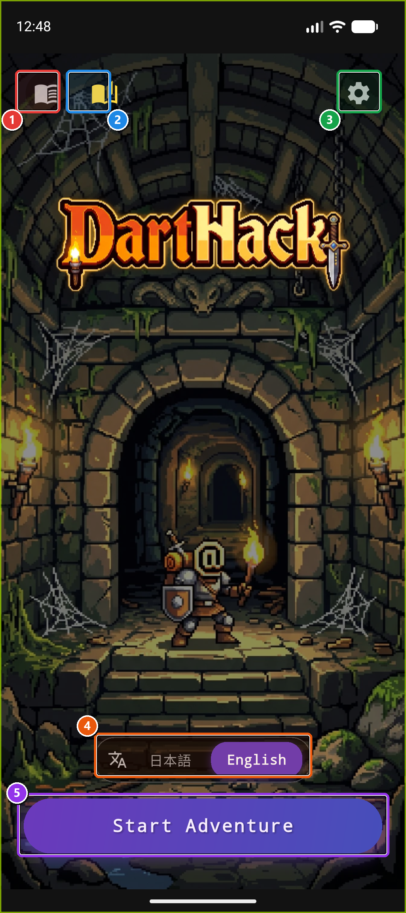
*Figure 1-1: Controls on the DartHack title screen*

1. **Guidebook / How to Play**: Opens the built-in NetHack Guidebook inside the app. Available before starting a run so beginners can check core rules at any time.
2. **Spoilers (Strategy Guide)**: Opens the built-in NetHack Spoilers collection for reference on mechanics, items, and monsters.
3. **DartHack Manual**: Opens this DartHack User Manual offline inside the app.
4. **Game Settings**: Opens the detailed settings screen covering tilesets, fonts, layout patterns, sound, and `defaults.nh`.
5. **Language Switcher (日本語 / English)**: Toggles between **English (upstream NetHack core)** and **日本語 (NetHackJP core)** for both the Flutter UI and the underlying game engine.
6. **Start Adventure**: Opens the character name & saved game selection dialog to begin or resume a game.

> [!NOTE]
> Select your preferred language (`English` or `日本語`) on the title screen before tapping **Start Adventure**.

---

## 2. Creating a Character & Resuming Saved Games

Tapping **Start Adventure** opens the **"Who are you?"** dialog where you enter your hero's name and select the play mode.

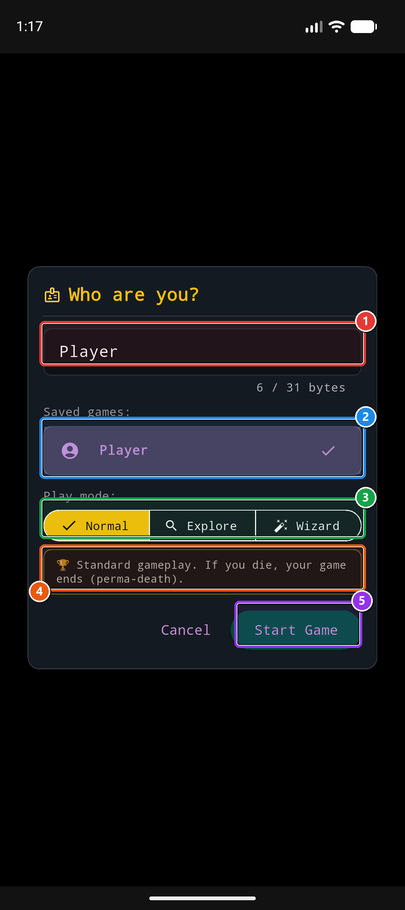
*Figure 2-1: Character name input, saved game selection, and play mode dialog*

1. **Character Name Input**: Enter a name for your adventurer (up to 31 bytes in UTF-8). Entering an existing saved character name resumes that run.
2. **Saved Games List**: If you have in-progress saved runs, they appear here. Tap any entry to auto-fill its name and resume from where you left off.
3. **Play Mode Switcher (Normal / Explore / Wizard)**: Choose between the three game modes.
4. **Play Mode Description**: Displays a summary of rules and scoring behavior for the currently selected mode.
5. **Start Game / Cancel**: Tap **Start Game** to launch into the dungeon (for new characters, role/race/tutorial prompts or auto-selection follow depending on options).

### Play Mode Comparison

| Mode | Rules & Features | High Score Recording |
| :--- | :--- | :--- |
| **Normal** | Classic roguelike perma-death. When you die, the run ends and your score is recorded. | Recorded on scoreboard |
| **Explore** | Practice/discovery mode allowing you to decline death and use exploration assists. | Not recorded as a standard run |
| **Wizard** | Debug/sandbox mode with special wizard commands (wishing, level teleport, etc.). | Not recorded |

---

## 3. Main Game Screen Overview

Once in the dungeon, the main play screen displays all game information and controls. In the default **Pattern 1** layout, elements are stacked top-to-bottom: **Status → Messages → Dungeon Map → D-Pad & Shortcuts → Command Panel**.

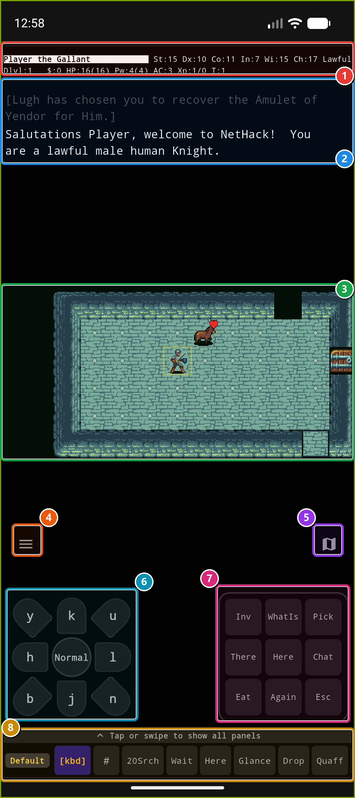
*Figure 3-1: Main game screen (Layout Pattern 1 with collapsed command panel)*

1. **Status Area**: Displays your character name & rank, attributes (`St/Dx/Co/In/Wi/Ch`), alignment, dungeon level (`Dlvl`), gold (`$`), HP, power (`Pw`), armor class (`AC`), experience level (`Xp`), and turn counter (`T`). With `hitpointbar` enabled, an HP gauge renders behind your name/rank. Tap the status area to view detailed character stats (`#attributes`), and tap weapon/armor fields (or long-press the status area) to open your equipment list (`#seeall`).
2. **Message Area**: Shows action results, combat messages, and discoveries. Tap anywhere in this area to open the full **Message History** sheet.
3. **Dungeon Map Area**: Renders the current level. Drag to pan, pinch to zoom in/out, and tap any tile to open a context-aware action menu.
4. **Floating Menu Button (Left)**: Opens the **DartHack Menu** drawer (Chapter 8). Its position can be customized in settings.
5. **Full Map Button (Right)**: Opens the **Full level map** overview dialog (Chapter 4).
6. **8-Way Directional Pad & Mode Button**: Eight directional buttons (`y k u / h . l / b j n`) move or attack in any direction. Tap the center button (initially **Normal**) to cycle through enabled movement modes (or send `.` during direction prompts), and **long-press** it to open **Select Movement Modes to Use** (run, `g`, `m`, `F`, etc.).
7. **3×3 Quick Shortcuts**: Nine one-tap shortcut buttons (default: `Inv`, `WhatIs`, `Pick`, `There`, `Here`, `Chat`, `Eat`, `Again`, `Esc`). **Long-press** any shortcut button to edit its assigned key/command and display label directly.
8. **Command Panel & Expand Handle**: A compact one-row strip of categorized action buttons. Tap or swipe upward on the handle to expand all command panels. **Long-press** any button on the panel to add, delete, or edit its command and label.

> [!TIP]
> **Handy Tap & Long-Press Shortcuts**
> - **Tap the Status Area**: View character attributes & resistances / **Tap weapon or armor (or long-press the Status Area)**: View your equipment list
> - **Long-press the 8-way D-Pad center button**: Open **Select Movement Modes to Use** (tap to cycle active modes)
> - **Long-press any 3×3 Quick Shortcut button**: Edit its assigned key/command and display label
> - **Long-press any Command Panel button**: Open the button customize menu (change command/label, add, delete, or reset panel)

### Expanding All Command Panels

Swipe up or tap the handle (1) above the command strip to view every registered panel simultaneously.

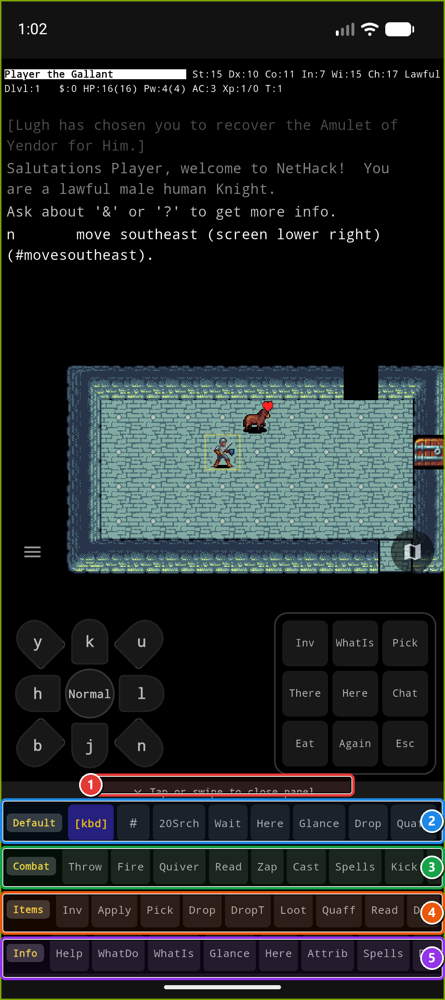
*Figure 3-2: Expanded bottom command panels*

1. **Expand / Collapse Handle**: Tap or swipe down to collapse the panels back into a single row.
2. **Default Panel**: Starts with `[kbd]` (switches between the 8-way D-Pad and full soft keyboard) followed by `#` (extended commands), `20Srch`, `Wait`, `Here`, `Glance`, `Drop`, `Quaff`, and more.
3. **Combat Panel**: Quick access to combat actions (`Throw`, `Fire`, `Quiver`, `Read`, `Zap`, `Cast`, `Spells`, `Kick`, etc.).
4. **Items Panel**: Inventory and item actions (`Inv`, `Apply`, `Pick`, `Drop`, `DropT`, `Loot`, `Quaff`, `Read`, etc.).
5. **Info Panel**: Reference commands (`Help`, `WhatDo`, `WhatIs`, `Glance`, `Here`, `Attrib`, `Spells`, etc.).

> [!TIP]
> Tap a panel badge on the left (e.g., `Default`, `Combat`) to make that panel active when collapsed, and swipe horizontally inside any row to reveal extra buttons. You can **long-press** any button directly on a panel to add, delete, or customize its key and label, or manage full panel layouts under **Game Settings → Edit Command Panel** (Chapter 15).

### Long-Press Customization for Command Panels

**Long-press** any button on a command panel (such as `20Srch`) to open the **Edit Button** dialog and customize it on the spot without opening Game Settings.

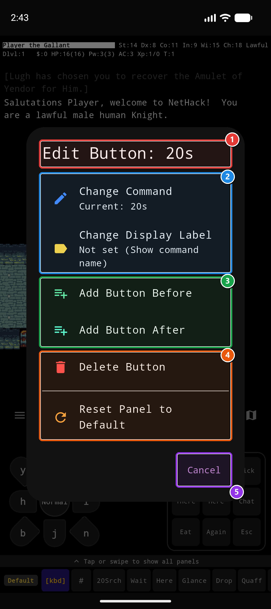
*Figure 3-3: Button customization menu opened by long-pressing a command panel button*

1. **Target Button Header**: Shows the current command assigned to the long-pressed button (e.g., `Edit Button: 20s`).
2. **Change Command & Display Label**: Tap **Change Command** to assign a new key/command (e.g., `20s`, `w`, `#pray`), or **Change Display Label** to set a custom button label (shows the command name when unset).
3. **Insert New Button**: Use **Add Button Before** or **Add Button After** to insert a new button next to the selected one.
4. **Delete / Reset**: Tap **Delete Button** to remove this button, or **Reset Panel to Default** to restore the active panel's built-in layout.
5. **Cancel**: Closes the dialog without applying changes.

### Switching Button Display Mode (Show Commands)

If you set **Game Settings → Controller Settings → Button Display Mode** (Chapter 14) to **Show Commands**, buttons display the raw input commands (`i`, `;`, `20s`, etc.) instead of descriptive label names (`Inv`, `Glance`, `20Srch`, etc.).

For players already familiar with classic NetHack keybindings, this setting makes it immediately obvious which key command each button sends.

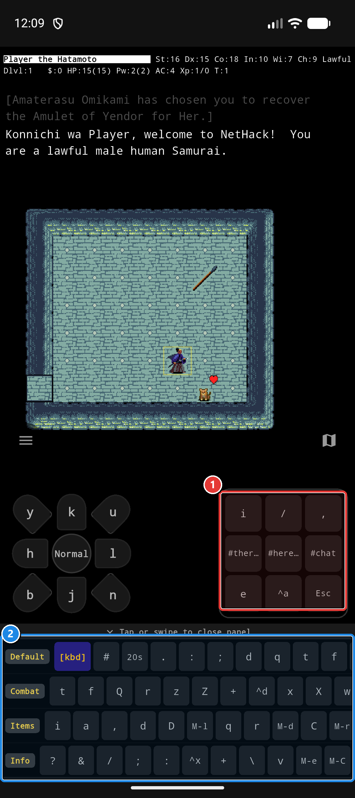
*Figure 3-4: 3×3 Quick Shortcuts and Command Panels in "Show Commands" mode*

1. **3×3 Quick Shortcuts (Command View)**: Buttons show raw keys and commands (`i`, `/`, `,`, `#ther...`, `#chat`, `e`, `^a`, etc.) instead of labels.
2. **Command Panels (Command View)**: Buttons along the bottom command panels likewise switch to raw keybindings such as `20s`, `.`, `:`, `;`, `d`, and `q`.

---

## 4. Movement Modes, Map Tapping & Full Level Map

### Selecting a Movement Mode

**Long-press** the center button on the 8-way D-Pad (`Normal`) to open **Select Movement Modes to Use**. Here you can pick temporary movement modes or toggle persistent options such as `F` (tap the center button briefly to cycle through enabled movement modes).

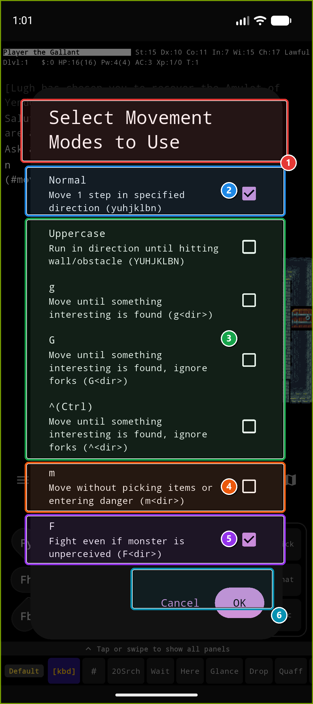
*Figure 4-1: Selecting directional movement modifiers*

1. **Dialog Header**: Title of the movement mode selector.
2. **Normal**: Moves 1 step in the chosen direction (`yuhjklbn`).
3. **Long-Distance Travel (`Uppercase` / `g` / `G` / `^(Ctrl)`)**: Choose **Uppercase (`YUHJKLBN`)** to run until hitting a wall/obstacle, **`g<dir>`** to travel until something interesting is found (stopping at forks), or **`G<dir>` / `^<dir>`** to ignore forks.
4. **`m` Mode (`m<dir>`)**: Moves onto a tile without picking up items and allows stepping onto dangerous terrain.
5. **`F` Mode (`F<dir>`)**: Attacks in a direction even when no monster is perceived there (toggleable so it stays active when needed).
6. **Cancel / OK**: Closes the dialog and applies your selection.

### Map Tap Context Menu

Tapping directly on a map tile opens a context-sensitive action menu tailored to where you tapped (your current square, an adjacent square, or a distant tile).

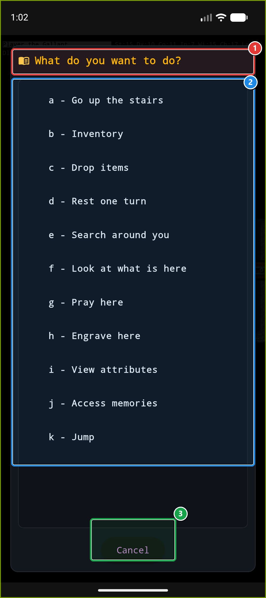
*Figure 4-2: Context-sensitive actions opened by tapping a dungeon tile*

1. **Prompt Header**: Displays the prompt (e.g., **"What do you want to do?"**).
2. **Action List**: Shows context-appropriate commands—current square actions (*Go up the stairs*, *Inventory*, *Rest one turn*, *Search*, *Pray here*, etc.), adjacent square **"Move here"** / door / combat actions, or distant inspection/travel options.
3. **Cancel Button**: Dismisses the menu without taking an action.

### Full Level Map

Tap the floating map icon on the right (or press `F9` / `Alt-z`) to view the entire explored dungeon level at once.

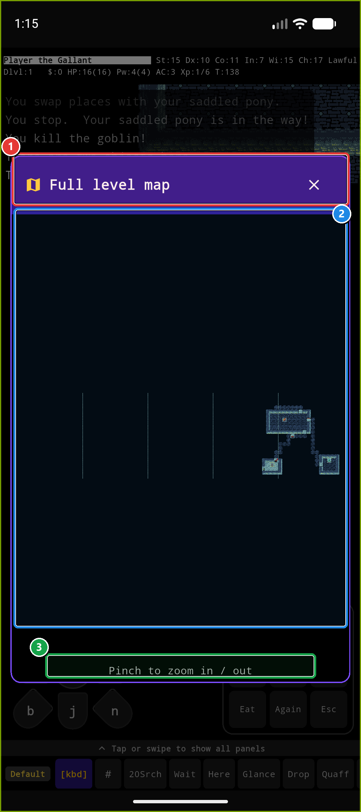
*Figure 4-3: Full level map overview*

1. **Header & Close (`×`)**: Shows the **Full level map** title and close button.
2. **Level Overview Canvas**: Displays all explored rooms, corridors, doors, stairs, and features on the current floor; drag to pan.
3. **Pinch-to-Zoom Hint**: Reminds you that pinching adjusts zoom level smoothly inside the overview.

---

## 5. Soft Keyboard & Extended Commands

### Full Soft Keyboard Mode

Tap **`[kbd]`** on the command panel to replace the D-Pad and 3×3 shortcuts with a full soft keyboard—ideal for typing classic single-letter commands or modifier combinations (`Ctrl`, `Meta`).

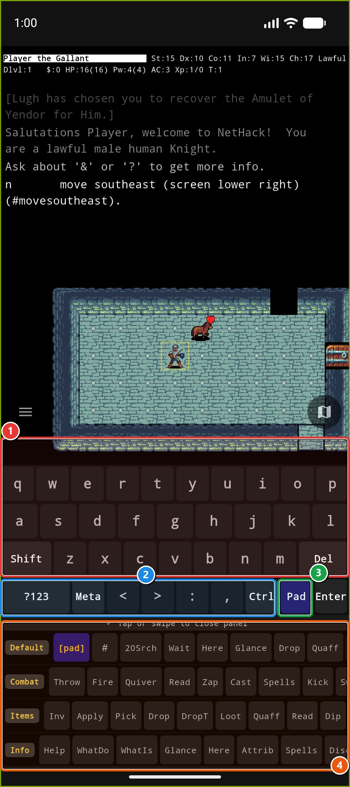
*Figure 5-1: Full QWERTY soft keyboard with modifier keys and command panels*

1. **QWERTY Alpha Section**: Keys `q`–`p`, `a`–`l`, `z`–`m`, plus `Shift` (uppercase) and `Del`.
2. **Modifiers & Symbol Bar**: Quick access to `?123` (numbers/symbols), `Meta`, `<` / `>` (stairs up/down), `:`, `,`, `Ctrl`, and `Enter`.
3. **`[Pad]` Toggle Button**: Returns immediately to the 8-way D-Pad and 3×3 quick shortcuts layout.
4. **Command Panels**: All four command rows remain accessible below the keyboard for hybrid input.

### Extended Commands (`#`)

Tap **`#`** on the command panel (or type `#`) to browse every extended command with descriptions and live search filtering.

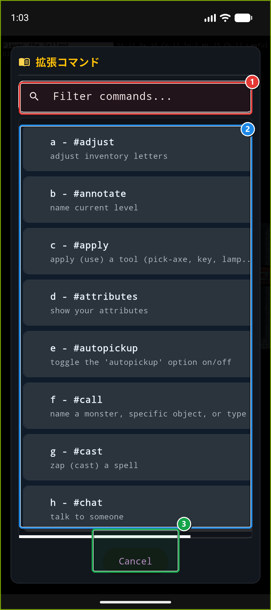
*Figure 5-2: Searchable extended commands list*

1. **Filter Search Box**: Type any part of a command name or description (such as `pray`, `loot`, or `adjust`) to filter the list instantly.
2. **Extended Command Rows**: Lists each command's selection letter, `#command` name, and description; tap any row to execute it.
3. **Cancel Button**: Closes the dialog without running a command.

---

## 6. Item Menus & Text Input Prompts

### Categorized Item Menu

When checking inventory (`i`), wielding weapons (`w`), wearing armor (`W`), quaffing (`q`), or reading (`r`), DartHack renders items grouped by category with tileset icons.

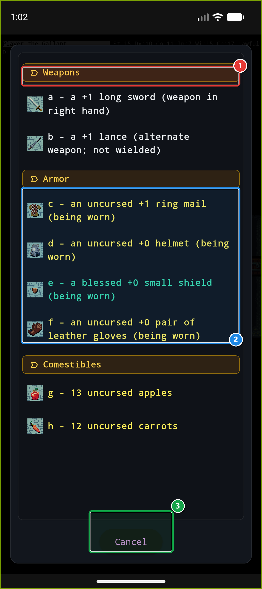
*Figure 6-1: Item selection menu with tile icons and BUC color coding*

1. **Category Headers**: Clearly separates *Weapons*, *Armor*, *Comestibles*, and other item classes.
2. **Item Rows**: Each row displays the inventory slot letter (`a`, `b`, `c`...), the item's tileset sprite, beatitude/status coloring (blessed/uncursed/cursed), count, and equipped state (`weapon in right hand`, `being worn`, etc.).
3. **Cancel Button**: Closes the menu without selecting an item.

### Naming & Text Input Prompt

When naming items (`C` / `#name`), making wishes, annotating levels, or entering text, a dedicated prompt dialog appears with context and history support.

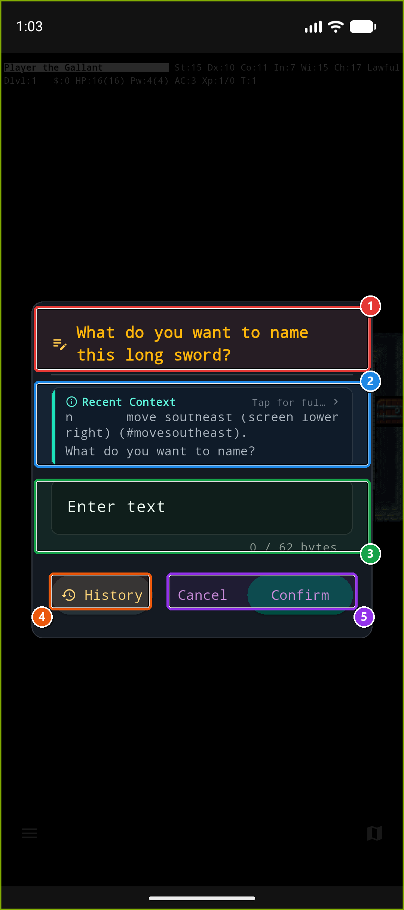
*Figure 6-2: Text input prompt with recent context preview, byte counter, and history*

1. **Prompt Question Header**: Shows what NetHack is asking for (e.g., *"What do you want to name this long sword?"*).
2. **Recent Context Card**: Displays the latest log lines right inside the prompt so you never lose track of which item or monster is referenced. Tap **"Tap for full..."** to open full history.
3. **Text Input Field & Byte Counter**: Supports standard system keyboards/IMEs and tracks the remaining byte budget allowed by the NetHack C core (e.g., `0 / 62 bytes`).
4. **History Button**: Lets you pick and reuse previously entered text strings.
5. **Cancel / Confirm**: Sends your input to the game engine or cancels the prompt.

---

## 7. Message History & Spoilers Viewer

### Message History Sheet

Tap the message area at the top of the play screen to slide up the **Message History** sheet.

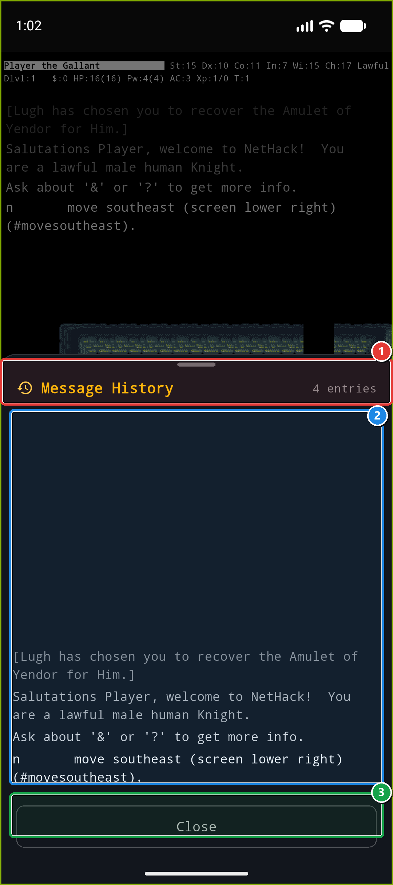
*Figure 7-1: Scrollable Message History bottom sheet*

1. **Sheet Header & Close Hint**: Displays the title and gesture hint (*Tap or swipe down to close*).
2. **Color-Coded Log List**: Shows recent and older messages in chronological order with highlighted warnings.
3. **Close Button**: Dismisses the sheet (or swipe down anywhere on the header).

### Spoilers & Guidebook Viewer

Accessible from the title screen book icons or **DartHack Menu → Read Spoilers / Read Guidebook**.

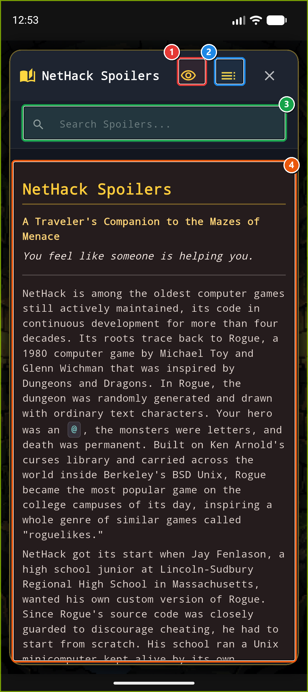
*Figure 7-2: Built-in Spoilers viewer with game peek, TOC, and search*

1. **Peek at Game Screen (Eye Icon)**: Tap to hold or long-press to peek through the viewer and inspect the dungeon screen underneath without losing your place.
2. **Open Table of Contents (TOC Icon)**: Jumps directly to any spoiler chapter.
3. **Search Bar**: Filters and finds matching terms across the spoiler document.
4. **Formatted Spoiler Content**: Renders sections, quotes, and inline symbols cleanly for mobile reading.

---

## 8. DartHack Menu (Drawer)

Tap the floating left menu button (or swipe from the left edge, or press `Ctrl+M` / `F10`) to open the **DartHack Menu** drawer.

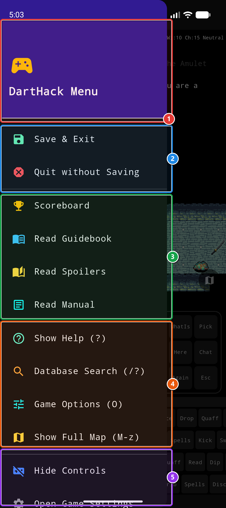
*Figure 8-1: DartHack drawer menu categories*

1. **Menu Header**: Displays the **DartHack Menu** banner.
2. **Save & Exit Controls**: Provides **Save & Exit** (saves your current run cleanly) and **Quit without Saving** (abandons the current run with confirmation).
3. **Records & Documentation**: Quick access to **Scoreboard** (Chapter 9), **Read Guidebook**, **Read Spoilers**, and **Read Manual** (offline user manual).
4. **Game Commands & Overlays**: Directly opens **Show Help (`?`)**, **Database Search (`/?`)**, **Game Options (`O`)**, and **Show Full Map (`M-z`)**.
5. **UI & App Settings**: Toggle **Hide Controls** to temporarily maximize map visibility, or tap **Open Game Settings** for Flutter app preferences (Chapters 10–16).

---

## 9. Scoreboard, Run Statistics & Tombstone

### Scoreboard

When a run ends or when opened from the DartHack Menu, the **Scoreboard** presents recorded entries as clean cards.

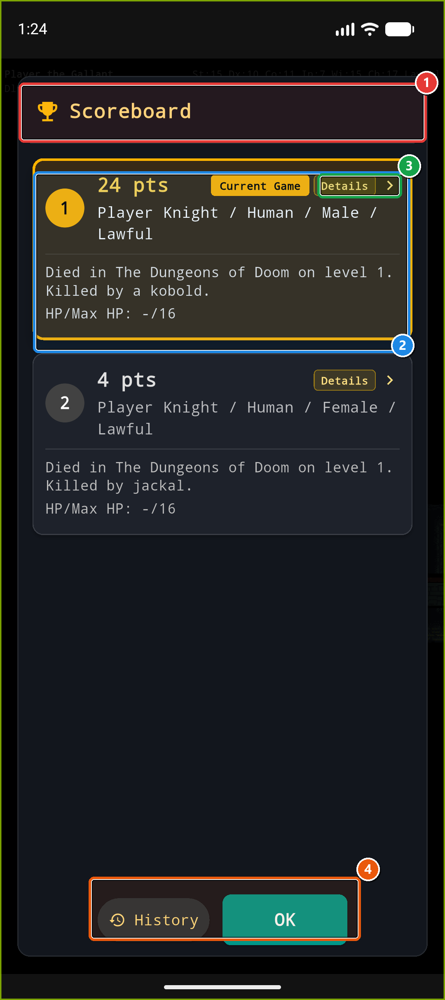
*Figure 9-1: Scoreboard cards highlighting the current run*

1. **Scoreboard Header**: Title banner of the rankings screen.
2. **Entry Cards**: Shows rank badge, points, character profile (*Name / Role / Race / Gender / Alignment*), fate, dungeon level, and HP/Max HP. The active/just-ended game is highlighted with a gold border and a **Current Game** badge.
3. **Details Button**: Tap **`Details >`** on any entry to inspect detailed play statistics for that run.
4. **History & OK**: Review the final message log via **History**, or tap **OK** to dismiss.

### Detailed Run Statistics (`xlogfile`)

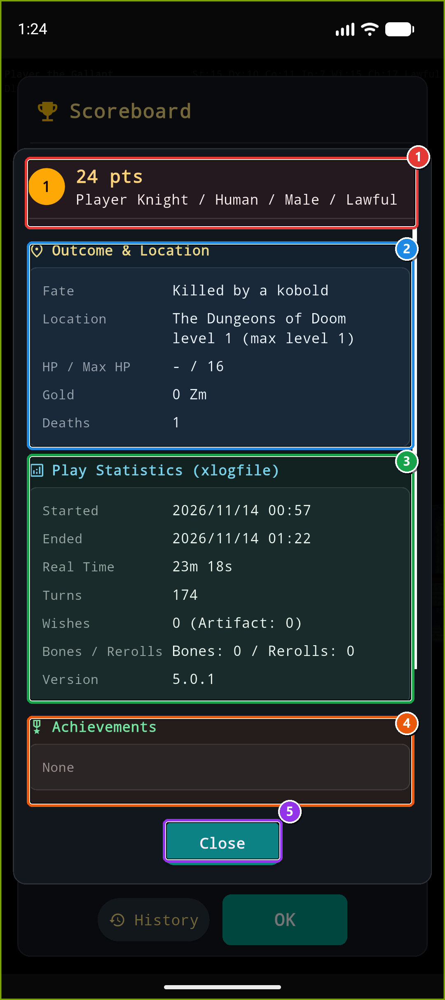
*Figure 9-2: Detailed outcome, xlogfile statistics, and achievements*

1. **Selected Entry Header**: Displays the rank, score, and full character summary.
2. **Outcome & Location**: Shows final fate, dungeon branch, depth (and max depth reached), HP / Max HP, gold (`Zm`), and death count.
3. **Play Statistics (`xlogfile`)**: Tracks start/end timestamps, real elapsed play time, turn count, wishes (and artifact wishes), bones/reroll counts, and NetHack version.
4. **Achievements**: Lists conducts and special accomplishments earned during the run.
5. **Close Button**: Returns to the Scoreboard list.

### Death Tombstone

When your character dies, a pixel-art tombstone screen commemorates the end of the run before advancing to the scoreboard.

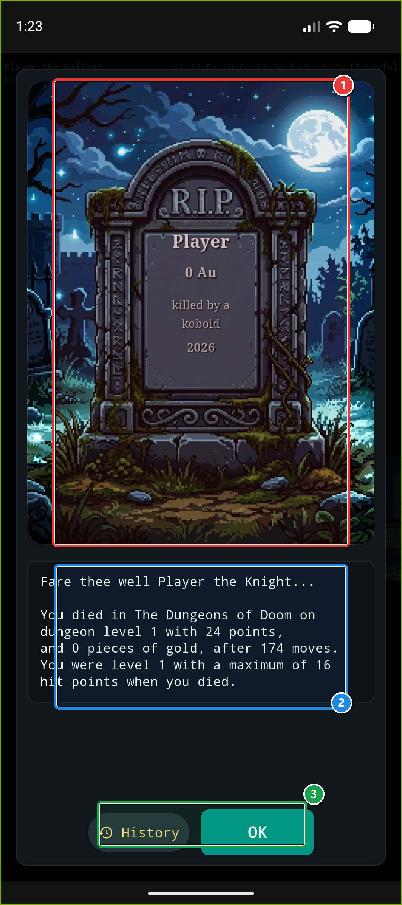
*Figure 9-3: Pixel-art R.I.P. tombstone and farewell summary*

1. **R.I.P. Tombstone Art**: Renders the pixel-art tombstone engraved with character name, cause of death, and year.
2. **Farewell Summary**: Summarizes your character's final belongings and fate.
3. **History & OK**: Check your final turns with **History** or continue with **OK**.

---

## 10. Selecting & Importing Tilesets

Access **Game Settings** from the title screen gear icon or **DartHack Menu → Open Game Settings**. Open **Tileset & Symbol Settings** at the top to toggle graphical tiles on/off or switch tilesets via **Select Tileset**.

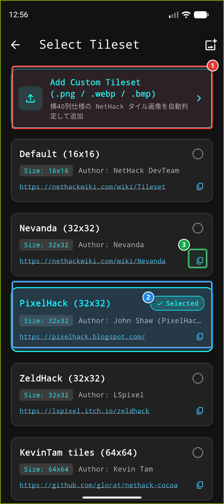
*Figure 10-1: Built-in tilesets and custom tileset importer*

1. **Add Custom Tileset (`.png` / `.webp` / `.bmp`)**: Import any standard **40-column NetHack tilesheet** (`width ÷ 40` columns). Non-square tiles (such as `15x25`) are automatically detected and rendered with accurate aspect ratios.
2. **Tileset Cards**: Displays all bundled and custom tilesets with pixel dimensions and author attribution; the active set displays a **Selected** badge (default: **PixelHack (32x32)**).
3. **Copy Source URL**: Tap the copy icon beside a tileset's URL to copy its homepage link to your clipboard.

### Bundled Tilesets

| Tileset | Resolution | Notes |
| :--- | :--- | :--- |
| **Default** | `16x16` | Classic standard NetHack 16×16 tiles |
| **Nevanda** | `32x32` | Clean, popular 32×32 pixel tileset |
| **PixelHack** | `32x32` | Default high-contrast 32×32 tileset |
| **ZeldHack** | `32x32` | Colorful Famicom/NES-style 32×32 tileset |
| **KevinTam tiles** | `64x64` | High-resolution transparent tiles with two-layer background terrain rendering |

---

## 11. Font, Display, Status & Message Area Settings

### Font Settings

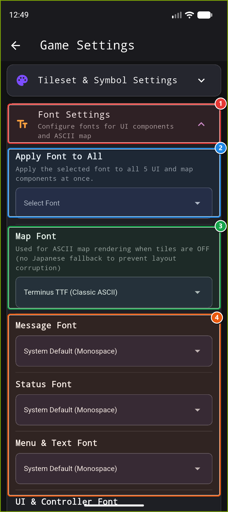
*Figure 11-1: Font Settings (Apply to All, Size Presets, Map Font & ASCII Scale)*

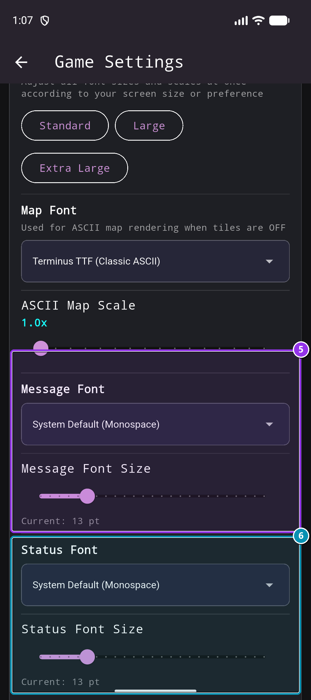
*Figure 11-2: Font Settings (Message & Status Fonts and Font Sizes)*

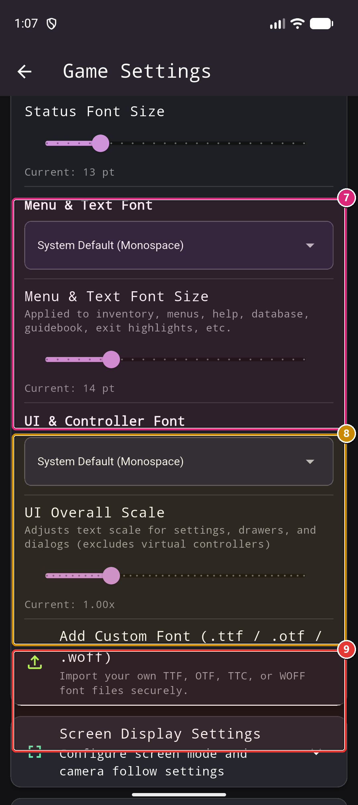
*Figure 11-3: Font Settings (Menu & Text, UI Overall Scale, and Custom Fonts)*

1. **Font Settings Header**: Expands unified typography and text-size controls.
2. **Apply Font to All**: Applies a single chosen font across all 5 UI and map categories at once.
3. **Size Preset (All)**: One-tap **Standard**, **Large**, and **Extra Large** presets to adjust all font sizes and scales together.
4. **Map Font & ASCII Map Scale**: Chooses the monospace font for ASCII map rendering when tiles are OFF (default: **Terminus TTF (Classic ASCII)**) and scales the ASCII map (`1.0x`, etc.).
5. **Message Font & Message Font Size**: Sets the font and size (`pt`) for the game message area.
6. **Status Font & Status Font Size**: Sets the font and size (`pt`) for the status bar.
7. **Menu & Text Font & Font Size**: Sets the font and size (`pt`) used across inventory, menus, help, database, guidebook, and exit highlights.
8. **UI & Controller Font & UI Overall Scale**: Adjusts the font and overall scale for settings, drawers, and dialogs (excluding virtual controllers).
9. **Add / Manage Custom Fonts**: Import `.ttf`, `.otf`, `.ttc`, or `.woff` files from device storage as custom fonts.

### Screen Display Settings

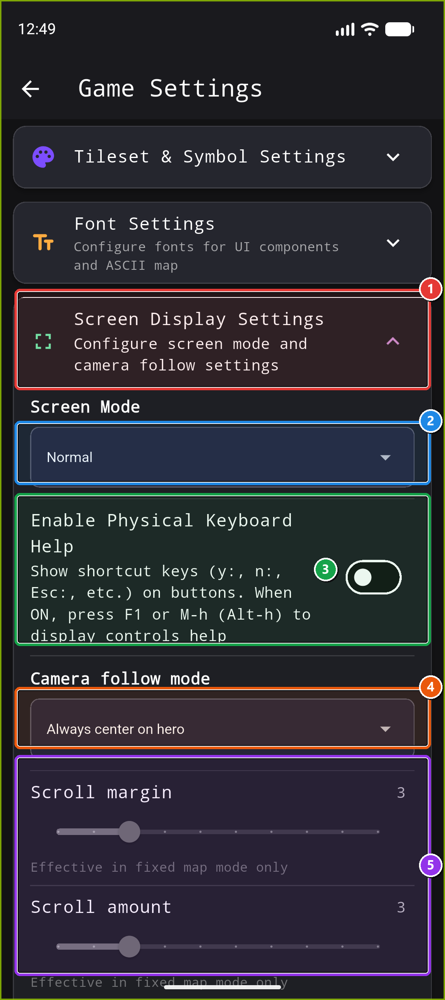
*Figure 11-4: Screen mode, physical keyboard hints, and camera follow behavior*

1. **Screen Display Settings Header**: Expands screen and camera behavior options.
2. **Screen Mode**: Chooses screen presentation mode (e.g., **Normal**).
3. **Enable Physical Keyboard Help**: Displays key hint labels (`y:`, `n:`, `Esc:`, etc.) on UI buttons and enables `F1` / `M-h (Alt-h)` help popup.
4. **Camera follow mode**: Switch between **Always center on hero** (re-centers the hero every move) and **Fixed map mode** (desktop-style static viewport that scrolls only near edges).
5. **Scroll margin & Scroll amount**: Active in **Fixed map mode** to control how many tiles from the edge scrolling triggers and how many tiles it shifts.

### Status Area Settings

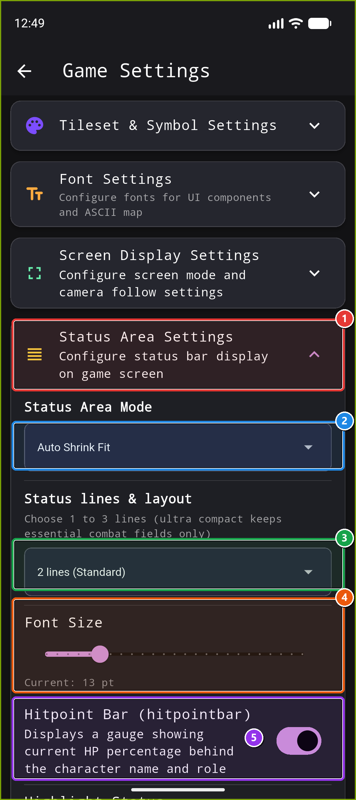
*Figure 11-5: Status Area display mode, line layout, hitpointbar, and status highlights*

1. **Status Area Settings Header**: Tap to expand or collapse status options.
2. **Status Area Mode**: Controls how text fits horizontally (e.g., **Auto Shrink Fit**).
3. **Status lines & layout**: Switches between 1-line, 2-line (Standard), 3-line, or ultra-compact combat layouts.
4. **Hitpoint Bar (`hitpointbar`)**: Draws a color-coded HP percentage gauge behind your character name and role.
5. **Highlight Status, Turns & Exp**: Toggle **Highlight Status (`hilite_status`)**, **Show Elapsed Turns (`time`)**, **Show Exp Points (`showexp`)**, and equipped weapon/armor summaries (font size controls have moved to **Font Settings**).

### Message Area Settings

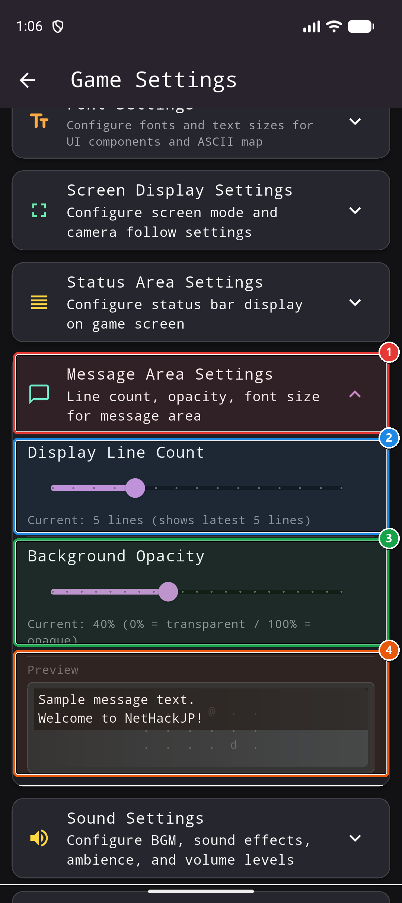
*Figure 11-6: Message Area line count, background opacity, and live preview*

1. **Message Area Settings Header**: Tap to expand or collapse message window options.
2. **Display Line Count**: Adjusts how many recent message lines (`1`–`15`) appear at the top of the screen.
3. **Background Opacity**: Controls the message box backdrop opacity (`0%` transparent to `100%` opaque) for balancing map visibility and text readability.
4. **Live Preview**: Previews the configured line count, opacity, and the font/size chosen in **Font Settings**.

---

## 12. Sound Settings

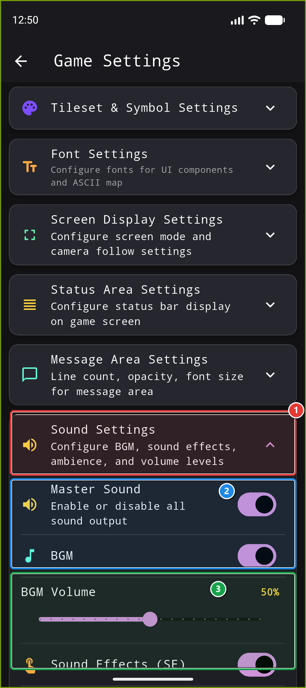
*Figure 12-1: Master sound, BGM, SE, and ambience settings*

1. **Sound Settings Header**: Expands audio options.
2. **Master Sound & BGM Toggles**: Use **Master Sound** to mute/unmute all audio, or toggle **BGM** independently.
3. **BGM Volume, Sound Effects (SE) & Ambience**: Adjust BGM volume with the slider (`0%`–`100%`) and toggle dungeon/combat SE and room/branch ambience.

---

## 13. UI Layout Customization & Tablet Mode

### Layout Patterns & Side Swapping

Customize where the status bar, messages, D-Pad, and shortcuts appear to match your hand size and preferred grip.

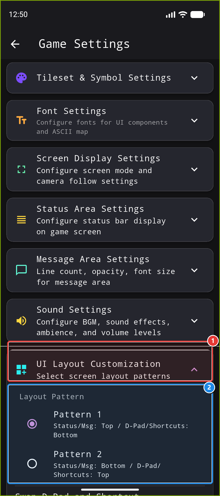
*Figure 13-1: Switching between Layout Pattern 1 and Pattern 2*

1. **UI Layout Customization Header**: Expands layout options.
2. **Layout Pattern**: Switch between **Pattern 1** (Status/Msg top, D-Pad/Shortcuts bottom) and **Pattern 2** (D-Pad/Shortcuts top, Status/Msg bottom); toggles below let you **Swap D-Pad and Shortcut Positions** left/right and reposition the floating menu button.

### Landscape & Tablet Layout

On wide landscape screens and tablets (such as `1920×1200`), DartHack adapts automatically to maximize dungeon visibility and place wide command panels along the bottom edge.

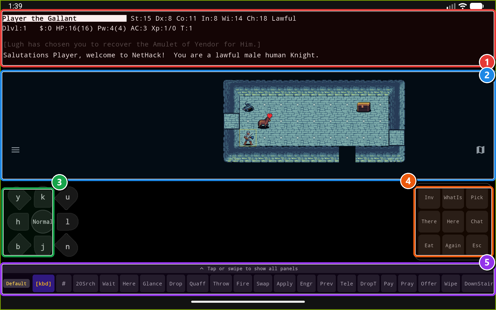
*Figure 13-2: Widescreen tablet layout in landscape orientation*

1. **Top Status & Message Area**: Full-width header fits status lines cleanly with generous message room.
2. **Expansive Dungeon Map & Side Floating Buttons**: Wide map viewport with unobtrusive floating Menu and Full Map buttons at left and right.
3. **Bottom-Left 8-Way D-Pad**: Positioned comfortably within left-thumb reach.
4. **Bottom-Right 3×3 Shortcuts**: Positioned within right-thumb reach.
5. **Wide Command Panel**: Displays nearly the entire active command strip side-by-side without scrolling.

---

## 14. Controller Settings

Under **Game Settings → Controller Settings**, you can configure button display mode, pad opacity, scale multipliers, long-press / far-tap travel behavior, PC/external mouse bindings, and the drawer menu swipe edge.

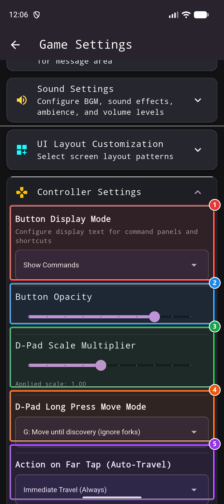
*Figure 14-1: Controller Settings (Button Display Mode, Opacity, D-Pad & Auto-Travel)*

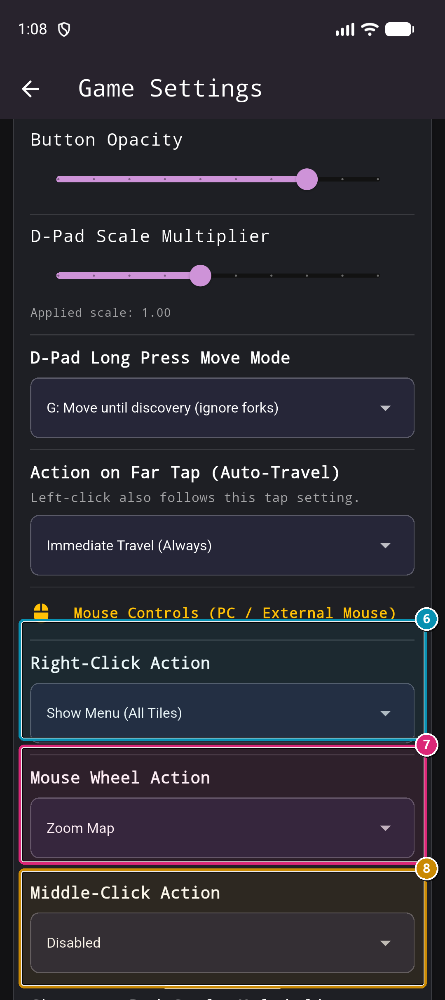
*Figure 14-2: Controller Settings (Mouse Controls: Right-Click, Wheel & Middle-Click)*

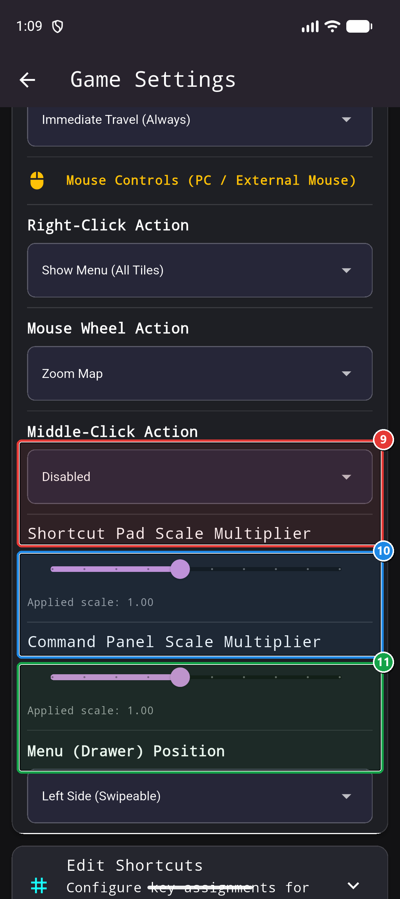
*Figure 14-3: Controller Settings (Shortcut/Panel Scales & Drawer Position)*

1. **Button Display Mode**: Choose **Show Labels** (default) or **Show Commands** (displays raw keys such as `i`, `;`, `20s` on command panels and 3×3 shortcuts—recommended for experienced NetHack players).
2. **Button Opacity**: Adjusts transparency (`0.1`–`1.0`) for the 8-way D-Pad, 3×3 shortcuts, and floating controls.
3. **D-Pad Scale Multiplier**: Scales the 8-way D-Pad between `0.6×` and `1.5×` (shows the clamped effective scale for your screen width below the slider).
4. **D-Pad Long Press Move Mode**: Chooses the directional travel mode triggered when long-pressing a D-Pad direction (Normal, Uppercase, `g`, `G`, `^`, `m`, or `F`).
5. **Action on Far Tap (Auto-Travel)**: Configures what happens when tapping a distant map tile (`Show Menu`, `Immediate Travel (Always)`, `After Scroll Only`, or `Disabled`). Left-click also follows this tap setting.
6. **Right-Click Action**: Sets what happens when right-clicking with a mouse (**Show Menu (All Tiles)**, **Smart Move**, **Direct Action**, or **Disabled**).
7. **Mouse Wheel Action**: Configures mouse wheel scrolling to **Zoom Map**, **Scroll Map**, or **Disabled**.
8. **Middle-Click Action**: Assigns middle-button (wheel click) to **Disabled**, **Show Menu (All Tiles)**, **Smart Move**, or **Direct Action**.
9. **Shortcut Pad Scale Multiplier**: Scales the 3×3 Quick Shortcut grid (`0.6×`–`1.5×`).
10. **Command Panel Scale Multiplier**: Scales the bottom Command Panel buttons (`0.6×`–`1.5×`).
11. **Menu (Drawer) Position**: Selects which screen edge opens the DartHack Menu (**Left Side (Swipeable)**, **Right Side**, **Top**, or **Bottom**).

---

## 15. Customizing Command Panels & Quick Shortcuts

Tailor the bottom command panels to match your favorite roles and playstyles.

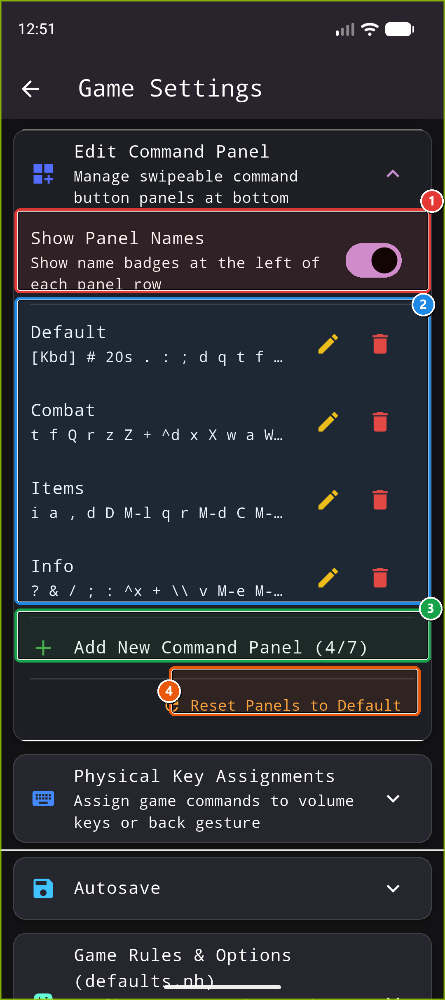
*Figure 15-1: Editing, adding, and resetting swipeable command panels*

1. **Show Panel Names**: Toggles the left-hand name badges (`Default`, `Combat`, `Items`, `Info`) on each panel row; turning them off frees horizontal width for extra buttons.
2. **Panel List (Edit / Delete)**: Shows each configured panel and its starting keys. Tap the **pencil icon** to edit button labels, commands, and ordering, or the **trash icon** to remove a custom panel.
3. **Add New Command Panel**: Create up to 7 custom panels (e.g., dedicated spellcasting or extended-command strips).
4. **Reset Panels to Default**: Restores the built-in 4-panel configuration (`Default`, `Combat`, `Items`, `Info`).

> [!TIP]
> You can also customize every slot in the 3×3 grid via **Quick Shortcut Settings** in Game Settings. On the main game screen, you can also **long-press** any Command Panel button or 3×3 Quick Shortcut button to edit its key and label directly (see Chapter 3, "Long-Press Customization for Command Panels").

---

## 16. Physical Keyboard Guide & Hardware Key Mapping

### Physical Keyboard Shortcuts

When using a physical keyboard (USB, Bluetooth, or Chromebook), enable **Game Settings → Screen Display Settings → Enable Physical Keyboard Help** to bring up the DartHack shortcut reference at any time by pressing `F1` or `Alt-h (M-h)`.

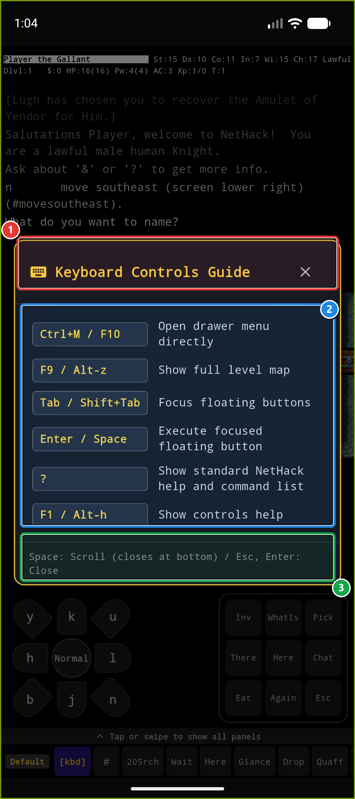
*Figure 16-1: Keyboard Controls Guide overlay*

1. **Guide Header & Close (`×`)**: Title bar for the controls guide.
2. **Shortcut List**: Quick reference for **`Ctrl+M` / `F10`** (open drawer menu), **`F9` / `Alt-z`** (full level map), **`Tab` / `Shift+Tab`** (focus floating buttons), **`Enter` / `Space`** (execute focused button), **`?`** (standard NetHack help), and **`F1` / `Alt-h`** (this guide).
3. **Navigation Footer**: Press `Space` to scroll (closes automatically at the bottom), or `Esc` / `Enter` to close immediately.

### Physical Key Assignments (Volume & Back Keys)

Even without a keyboard, you can bind hardware **Volume Up**, **Volume Down**, and the Android **Back button** to frequent NetHack commands.

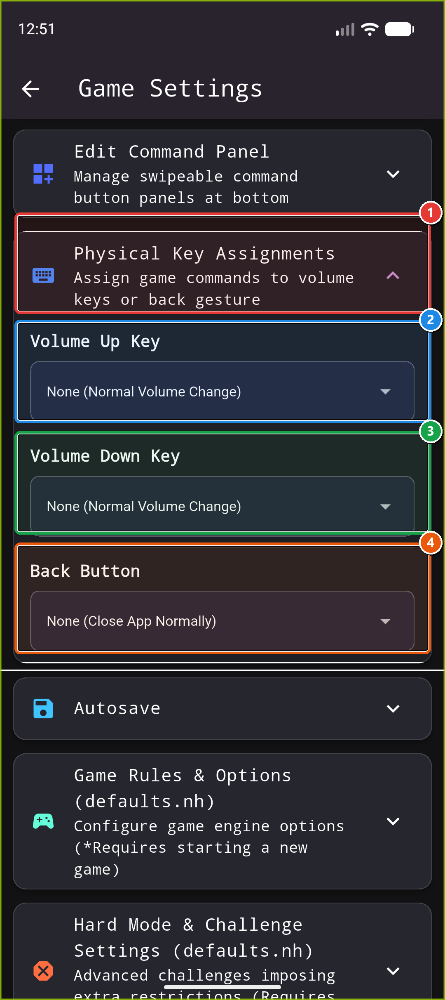
*Figure 16-2: Binding Volume keys and Back gesture in Game Settings*

1. **Physical Key Assignments Header**: Expands hardware button bindings.
2. **Volume Up Key**: Assign a game command (default: `None (Normal Volume Change)`).
3. **Volume Down Key**: Assign a game command (default: `None (Normal Volume Change)`).
4. **Back Button**: Customize back gesture/button behavior (default: `None (Close App Normally)`).

---

## 17. Game Rules & Challenge / Hard Modes

DartHack exposes key `defaults.nh` rules and built-in challenge conducts directly in Game Settings.

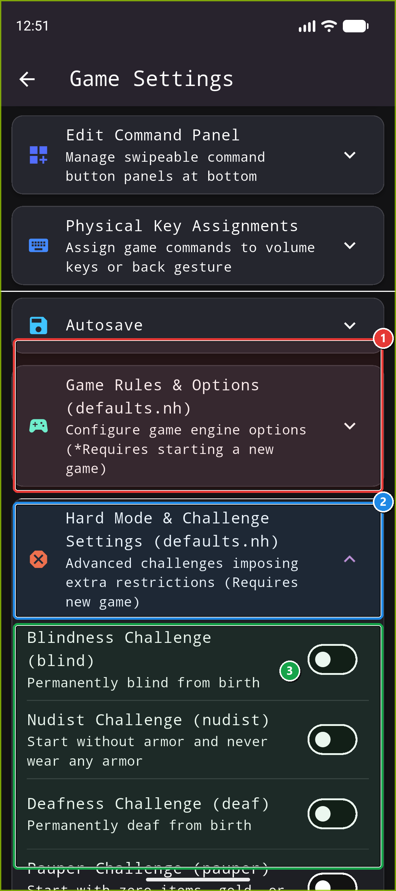
*Figure 17-1: Game Rules & Options and Hard Mode challenge toggles*

1. **Game Rules & Options (`defaults.nh`)**: Configure core engine behaviors such as autopickup and prompts (*Requires starting a new game*).
2. **Hard Mode & Challenge Settings (`defaults.nh`) Header**: Expands advanced challenge toggles (*Requires starting a new game*).
3. **Challenge Toggles**: Toggle restrictions such as **Blindness Challenge (`blind`)**, **Nudist Challenge (`nudist`)**, **Deafness Challenge (`deaf`)**, and **Pauper Challenge (`pauper`)** (scroll down for more challenges).

---

## 18. Advanced Settings (Editing `defaults.nh` & Backup)

At the bottom of Game Settings, advanced users can edit the raw NetHack configuration file or back up/transfer their Flutter UI setup.

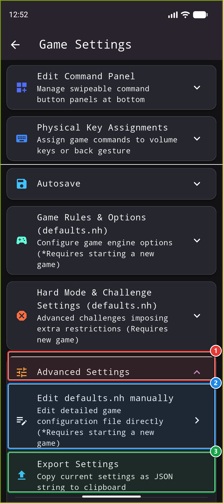
*Figure 18-1: Manual defaults.nh editing and JSON settings export/import*

1. **Advanced Settings Header**: Expands power-user tools.
2. **Edit `defaults.nh` manually**: Opens a direct text editor for `defaults.nh`, letting you write any classic NetHack options (`OPTIONS=...`, `MENUCOLOR=...`, custom status highlights, etc.). *Requires starting a new game for changes to take effect.*
3. **Export Settings / Import Settings**: Tap **Export Settings** to copy all UI, font, layout, command panel, and shortcut preferences as a JSON string to your clipboard, or use **Import Settings** below to restore them on another device.

---

*Happy dungeoneering — may the RNG smile upon you!*
